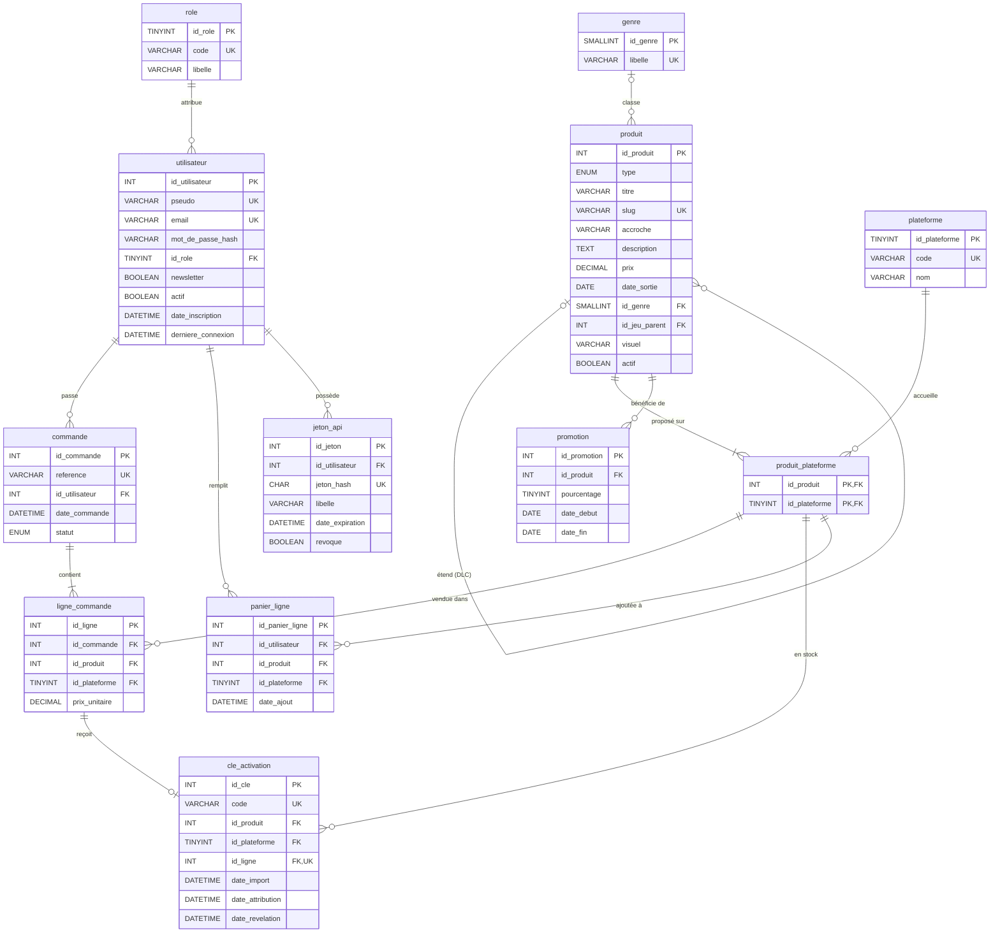
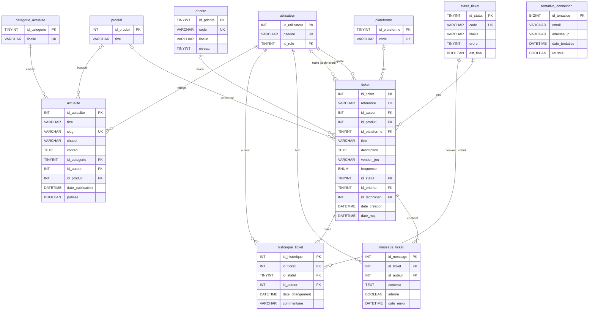

# Schéma de la base (Mermaid)

GitHub affiche ces diagrammes directement. Version image : [livrable 2](../docs/monde-2/1-conception-backend/L2_representation_bdd.md).

## Comptes, catalogue, commandes et clés

## Support, actualités et sécurité

