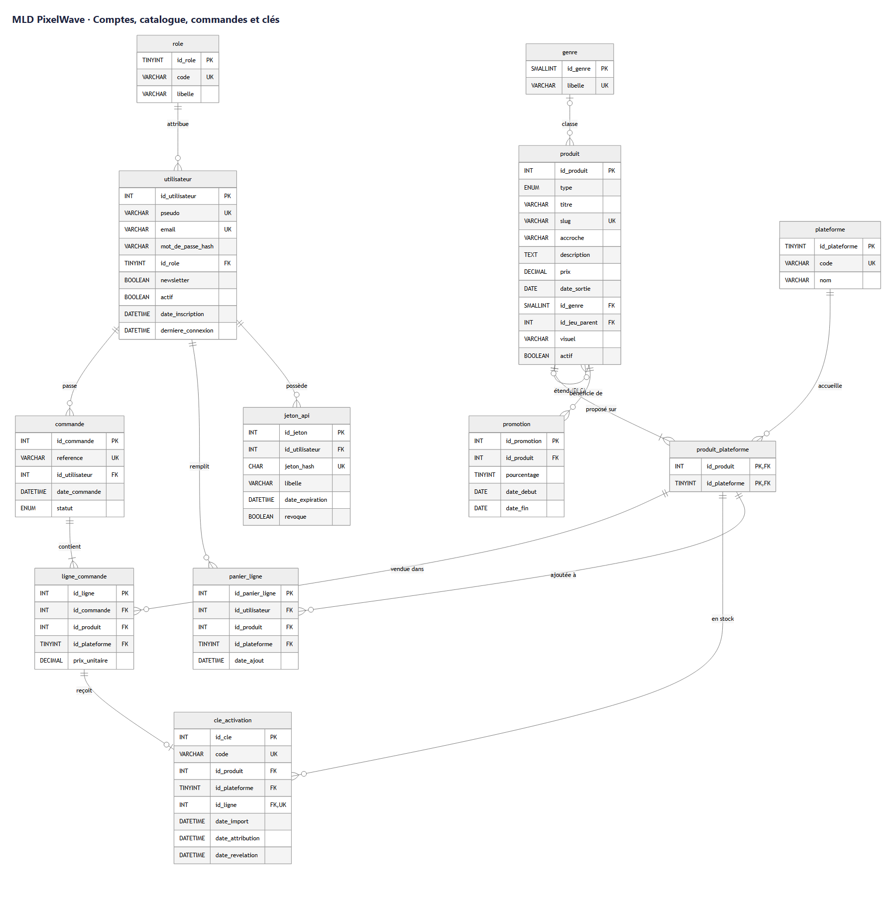
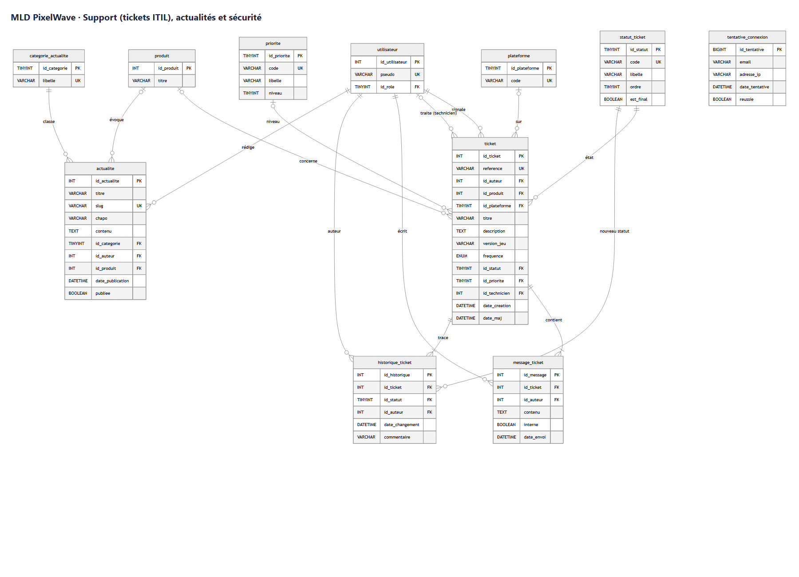

# Livrable 2 : représentation de la base de données

J'ai suivi la méthode Merise vue en cours : d'abord le MCD (niveau conceptuel), ensuite le MLD (les tables, sous forme de schéma plus bas), et enfin le MPD, qui correspond au script SQL du [livrable 4](L4_script_creation.md).

## 1. Le MCD

Pour chaque association, j'ai noté les cardinalités. Exemple de lecture pour PASSER : un utilisateur passe 0 ou plusieurs commandes, et une commande est passée par un seul utilisateur.

| Association | Entité A | Card. A | Entité B | Card. B |
|---|---|---|---|---|
| AVOIR (profil) | UTILISATEUR | 1,1 | ROLE | 0,n |
| PASSER | UTILISATEUR | 0,n | COMMANDE | 1,1 |
| CONTENIR | COMMANDE | 1,n | LIGNE_COMMANDE | 1,1 |
| ÊTRE DISPONIBLE SUR | PRODUIT | 1,n | PLATEFORME | 0,n |
| CONCERNER | LIGNE_COMMANDE | 1,1 | PRODUIT + PLATEFORME | 0,n |
| ATTRIBUER | LIGNE_COMMANDE | 1,1 | CLE_ACTIVATION | 0,1 |
| CLASSER | PRODUIT | 0,1 | GENRE | 0,n |
| ÉTENDRE (DLC) | PRODUIT (DLC) | 0,1 | PRODUIT (jeu) | 0,n |
| BÉNÉFICIER | PRODUIT | 0,n | PROMOTION | 1,1 |
| METTRE AU PANIER | UTILISATEUR | 0,n | PRODUIT + PLATEFORME | 0,n |
| SIGNALER | UTILISATEUR | 0,n | TICKET | 1,1 |
| TRAITER | UTILISATEUR (support) | 0,n | TICKET | 0,1 |
| ÊTRE DANS L'ÉTAT | TICKET | 1,1 | STATUT_TICKET | 0,n |
| AVOIR LA PRIORITÉ | TICKET | 0,1 | PRIORITE | 0,n |
| ÉCRIRE | UTILISATEUR | 0,n | MESSAGE_TICKET | 1,1 |
| TRACER | TICKET | 1,n | HISTORIQUE_TICKET | 1,1 |
| RÉDIGER | UTILISATEUR | 0,n | ACTUALITE | 1,1 |
| POSSÉDER (jeton) | UTILISATEUR | 0,n | JETON_API | 1,1 |

## 2. Passage au MLD

J'ai appliqué les règles du cours :

- chaque entité devient une table, et son identifiant devient la clé primaire (un entier en auto-incrément) ;
- pour une association 1 à plusieurs, la clé étrangère va du côté où la cardinalité max est 1. Par exemple `commande.id_utilisateur` ;
- pour une association plusieurs à plusieurs, je crée une table associative. C'est le cas de `produit_plateforme (id_produit, id_plateforme)` ;
- l'association ÉTENDRE relie la table produit à elle-même, donc elle devient la clé étrangère `produit.id_jeu_parent`.

Un choix que je trouve important : une clé d'activation, une ligne de commande ou une ligne de panier ne pointent pas vers le produit et la plateforme chacun de leur côté. Elles pointent vers le couple de `produit_plateforme`, avec une clé étrangère sur deux colonnes. Comme ça, si Abyssal Tides n'existe que sur PC, la base refuse toute seule une clé « Abyssal Tides PS5 ».

## 3. Le schéma

La base a 20 tables et une vue. J'ai fait deux schémas parce qu'un seul devenait illisible. PK veut dire clé primaire, FK clé étrangère et UK valeur unique. Chaque trait relie une clé étrangère à la clé primaire qu'elle référence, avec la cardinalité de chaque côté (la patte d'oie veut dire plusieurs, la barre un seul, le rond zéro possible).

### Comptes, catalogue, commandes et clés

### Support, actualités et sécurité

J'ai aussi mis ces schémas en version texte : [`database/schema.dbml`](../../../database/schema.dbml) se colle directement sur [dbdiagram.io](https://dbdiagram.io), et [`database/schema.md`](../../../database/schema.md) s'affiche comme un diagramme sur GitHub.

## 4. À quoi sert chaque table

| Table | Contenu | Utilisée pour |
|---|---|---|
| `role` | joueur, support, admin | les droits d'accès |
| `utilisateur` | les comptes des joueurs et du studio | compte, connexion |
| `jeton_api` | les jetons d'accès à l'API | l'API REST |
| `tentative_connexion` | le journal des connexions | bloquer la force brute |
| `genre`, `plateforme` | listes de référence | la boutique |
| `produit` | les jeux et les DLC | boutique, bibliothèque |
| `produit_plateforme` | un produit disponible sur une plateforme | le choix de la plateforme |
| `promotion` | les réductions avec leurs dates | le badge « -30 % » |
| `panier_ligne` | le panier en cours | la boutique |
| `commande`, `ligne_commande` | les achats et les prix payés | historique, bibliothèque |
| `cle_activation` | le stock de clés et à qui elles sont attribuées | « Ma bibliothèque » |
| `categorie_actualite`, `actualite` | les actualités du studio | accueil, page Actualités |
| `statut_ticket`, `priorite` | les étapes et niveaux d'un ticket | le support |
| `ticket`, `message_ticket`, `historique_ticket` | les signalements, les échanges, le suivi | signaler et suivre un bug |
| vue `v_produit_prix` | le prix du jour avec la promo | calculer le prix au même endroit partout |
