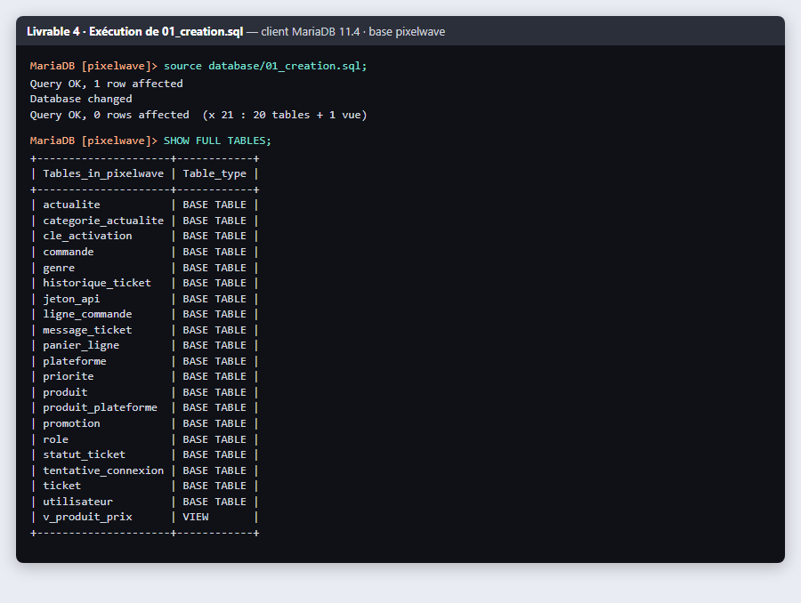
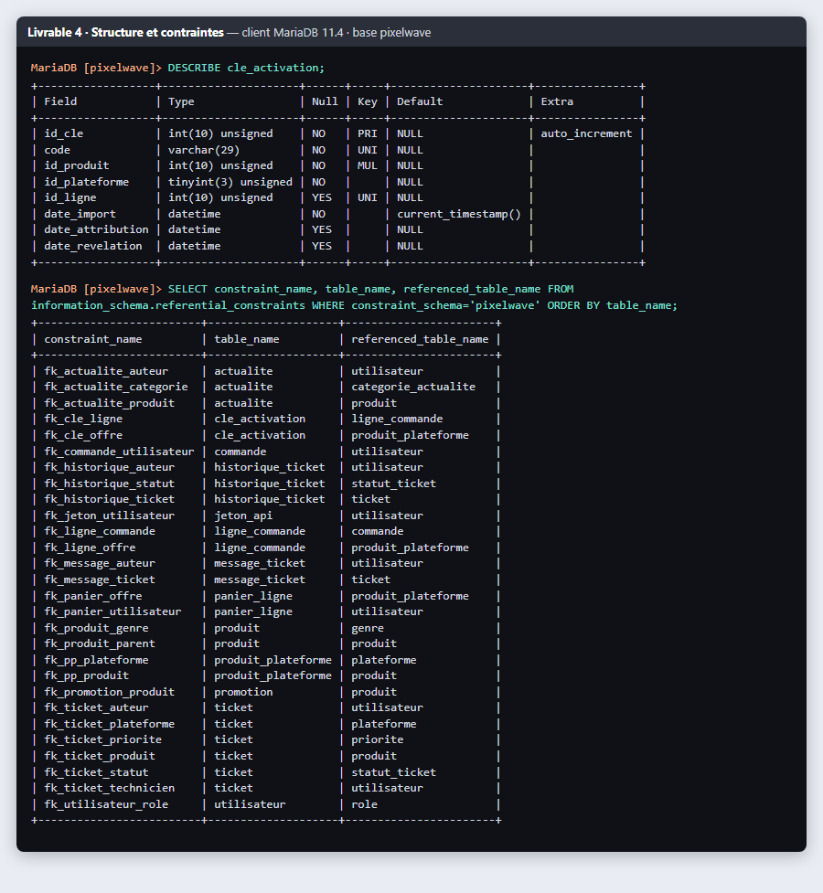

# Livrable 4 · Script de création des tables

**Fichier : [`database/01_creation.sql`](../../../database/01_creation.sql)** (MariaDB 10.11+ / MySQL 8, moteur InnoDB, encodage `utf8mb4`).

## Ordre de création

Une table référencée doit exister avant celle qui la référence :

1. **Tables de référence**, sans clé étrangère : `role`, `plateforme`, `genre`, `statut_ticket`, `priorite`, `categorie_actualite`
2. **Tables principales** : `utilisateur`, `produit`, `actualite`, `promotion`, `commande`, `ticket`, `jeton_api`, `tentative_connexion`
3. **Tables associatives et de suivi** : `produit_plateforme`, `ligne_commande`, `cle_activation`, `panier_ligne`, `message_ticket`, `historique_ticket`
4. **Vue** `v_produit_prix`

Le script commence par `DROP DATABASE IF EXISTS` : il est rejouable et recrée toujours la même structure.

## Contraintes utilisées

| Contrainte | Exemples | Règle garantie par la base |
|---|---|---|
| `PRIMARY KEY` + `AUTO_INCREMENT` | toutes les tables | identifiant unique généré automatiquement |
| `NOT NULL` | `utilisateur.email`, `ticket.titre` | champ obligatoire |
| `UNIQUE` | `utilisateur.email`, `utilisateur.pseudo`, `cle_activation.code`, `cle_activation.id_ligne` | pas de doublon ; une ligne de commande reçoit une seule clé |
| `DEFAULT` | `utilisateur.actif = TRUE`, `commande.statut = 'payee'` | valeur par défaut |
| `FOREIGN KEY` | 31 clés étrangères | intégrité référentielle |
| `FOREIGN KEY` composée | `cle_activation (id_produit, id_plateforme) → produit_plateforme` | une clé n'existe que pour une plateforme réellement proposée |
| `ON DELETE CASCADE` | `message_ticket → ticket`, `panier_ligne → utilisateur` | supprimer un ticket supprime ses messages |
| `ON DELETE SET NULL` | `actualite.id_produit` | retirer un produit ne supprime pas l'actualité |
| `CHECK` | `prix >= 0`, `pourcentage BETWEEN 1 AND 90`, `date_fin >= date_debut` | valeurs cohérentes |
| `CHECK` métier | `ck_produit_dlc` : un DLC a un jeu parent, un jeu n'en a pas | règle du catalogue |
| `ENUM` | `produit.type`, `commande.statut`, `ticket.frequence` | liste de valeurs fermée |

## Types retenus

| Type | Usage dans le projet |
|---|---|
| `INT UNSIGNED` / `TINYINT UNSIGNED` | identifiants (TINYINT pour les petites listes de référence) |
| `DECIMAL(6,2)` | prix : valeur exacte, jamais `FLOAT` pour de l'argent |
| `VARCHAR(n)` | textes courts ; `VARCHAR(255)` pour l'empreinte de mot de passe (taille d'un futur argon2) |
| `CHAR(64)` | empreinte SHA-256 d'un jeton (longueur fixe) |
| `VARCHAR(45)` | adresse IP (IPv6 comprise) |
| `TEXT` | descriptions, messages |
| `DATE` / `DATETIME` | dates de sortie, horodatages |
| `BOOLEAN` | indicateurs (`actif`, `newsletter`, `interne`...) |

## Exécution

Dans phpMyAdmin : onglet **Importer** → `01_creation.sql` → **Exécuter**. En ligne de commande :

```bash
mariadb -u root -p < database/01_creation.sql
```

## Captures d'écran

Exécution réelle sur MariaDB 11.4 (client en ligne de commande) : les 20 tables et la vue sont créées.



Structure d'une table et liste des 31 clés étrangères créées :



> Sur le serveur du projet, la même vérification peut être faite dans phpMyAdmin (onglet **Structure** de la base `pixelwave`, puis **Concepteur** pour voir les liaisons).
