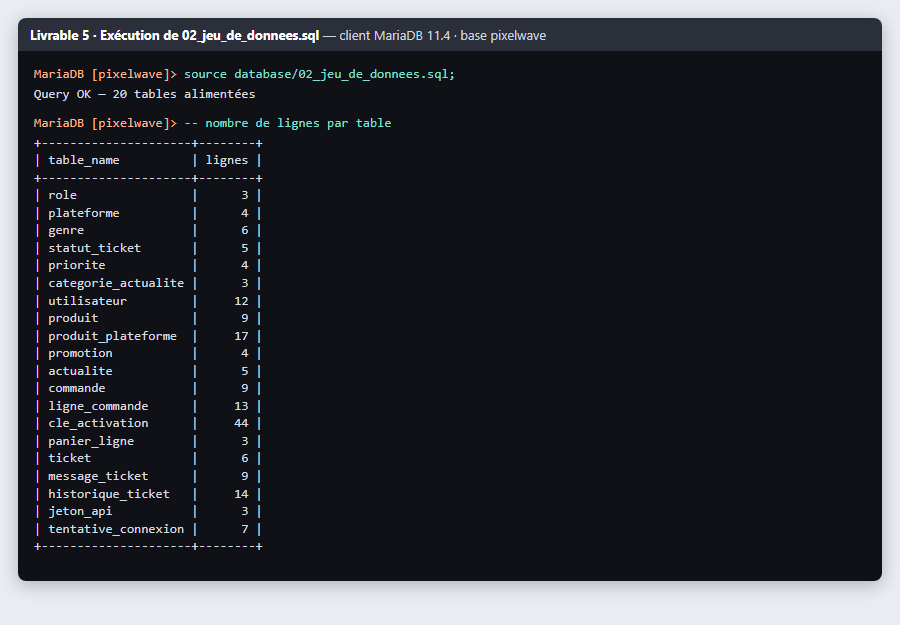
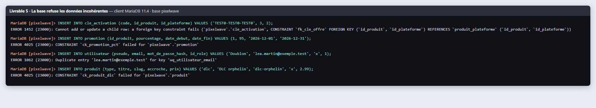

# Livrable 5 : jeu de données

Le script est dans [`database/02_jeu_de_donnees.sql`](../../../database/02_jeu_de_donnees.sql), il se lance après `01_creation.sql`.

Toutes les données sont inventées. Les adresses e-mail finissent en `.test`, un domaine réservé qui n'appartient à personne, et les clés d'activation ont été générées au hasard. Il n'y a aucun vrai nom ni aucune vraie coordonnée. Les mots de passe sont enregistrés sous forme d'empreintes bcrypt, que j'ai générées avec `password_hash()` en PHP.

## Ordre d'insertion

J'insère dans le même ordre que la création : d'abord les tables de référence, puis les utilisateurs, les produits, les offres (`produit_plateforme`), les promotions, les actualités, les commandes, les lignes, les clés, les paniers, les tickets, les messages, l'historique, les jetons et enfin le journal de connexion. Les identifiants sont écrits en dur. Ça rend les clés étrangères plus faciles à lire, et le script reconstruit toujours exactement la même base.

## Ce qu'il y a dedans

- 12 utilisateurs : 1 admin, 2 personnes du support et 9 joueurs.
- 9 produits : 5 jeux et 4 DLC, ceux de la maquette Figma.
- 17 offres (un produit sur une plateforme).
- 4 promotions : deux en cours, une terminée et une à venir.
- 9 commandes et 13 lignes de commande, dont une commande remboursée et une avec le même jeu sur deux plateformes.
- 44 clés : 13 vendues (affichées ou pas encore) et 31 en stock.
- 6 tickets avec 9 messages et 14 lignes d'historique, au moins un ticket par statut.
- 5 actualités, dont une en brouillon.
- 3 jetons d'API : un valide, un expiré et un révoqué.
- Les listes de référence, quelques paniers et un journal de connexion.

## Les cas particuliers que j'ai prévus

Le cours demande de couvrir aussi les cas limites, donc j'ai ajouté :

| Cas | Donnée de test | Pour vérifier |
|---|---|---|
| joueur qui n'a rien acheté | NoobSaibot | bibliothèque vide, requête R11 |
| compte désactivé | OldTimer | que la connexion est refusée |
| plateforme sans aucun produit | Xbox Series | que le filtre renvoie une liste vide |
| genre sans jeu | Plateforme | les jointures externes |
| produit retiré de la vente | Tiny Forge : Pack de démarrage | qu'il n'apparaît pas dans la boutique |
| jeu pas encore sorti | Pocket Galaxy (10/12/2026) | le badge « Précommande » |
| plus de clé en stock | Starlit Courier sur Switch | que l'achat est bloqué (erreur 409) |
| dernière clé en stock | Livrées rétro sur PS5 | l'alerte de stock (R15) |
| promo en cours, terminée, à venir | Abyssal Tides -30 %, Neon Drift -50 % en juillet, Starlit Courier -20 % en décembre | que seule la promo du jour est appliquée |
| prix payé différent du prix actuel | Abyssal Tides acheté 17,49 € | que l'historique garde le bon prix |
| commande remboursée | CMD-2026-000008 | que le jeu disparaît de la bibliothèque |
| même jeu sur deux plateformes | StarRunner, Starlit Courier PS5 et Switch | qu'il y a bien deux clés différentes |
| ticket pas encore traité | BUG-2026-0004, sans priorité ni technicien | les jointures externes et la file du support |
| note interne du support | BUG-2026-0001 | que le joueur ne la voit pas |
| actualité en brouillon | « Pocket Galaxy : la date de sortie » | qu'elle n'est pas publiée |
| tentatives de connexion ratées | 3 échecs depuis `192.0.2.200` | la requête R16 |
| champs facultatifs vides | ticket sans version, produit sans description | la gestion des `NULL` |
| adresse IPv6 | `2001:db8::42` | que le champ est assez long |

## Exécution

Le jeu de données est bien chargé, avec le nombre de lignes par table :

Et la base refuse bien les données incohérentes : une clé pour une plateforme non proposée, une réduction de 95 %, un e-mail déjà utilisé et un DLC sans jeu parent.

