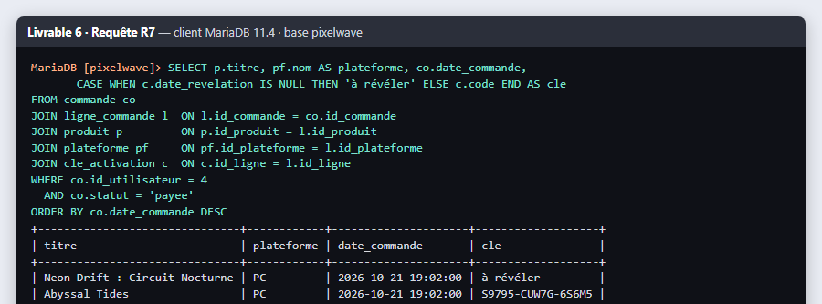
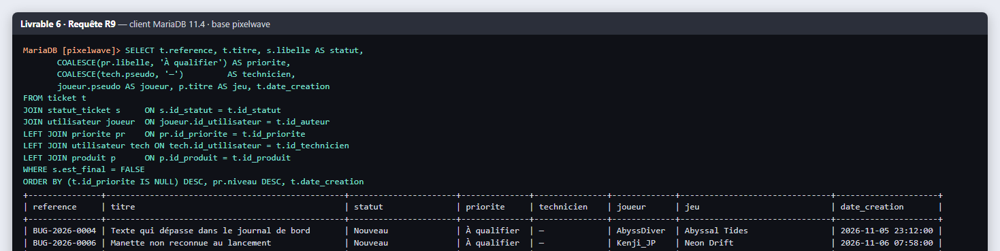
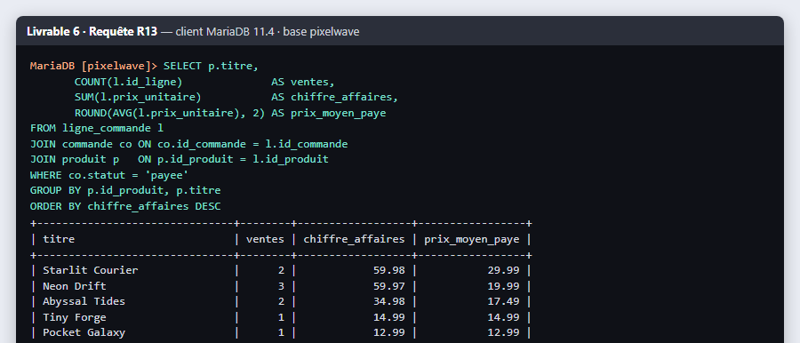
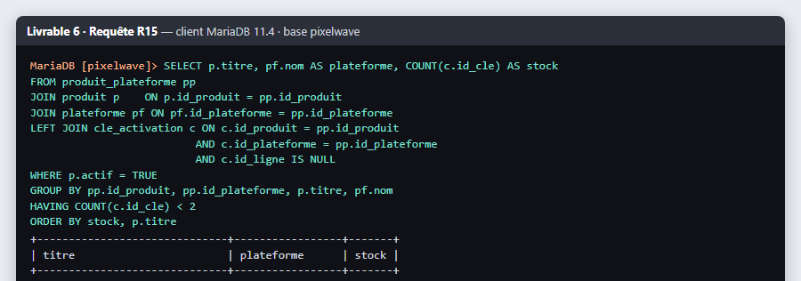

# Livrable 6 · Requêtes SQL

**Fichier : [`database/03_requetes.sql`](../../../database/03_requetes.sql)** — 26 requêtes commentées, toutes exécutées sur le jeu de données du livrable 5.

La partie « modification » (INSERT, UPDATE, DELETE) est encadrée par `START TRANSACTION ... ROLLBACK` : le script peut être rejoué sans abîmer les données de test.

## Liste des requêtes

| N° | Besoin du portail | Instructions utilisées |
|---|---|---|
| R1 | Boutique : produits en vente, les plus récents d'abord, prix du jour | `SELECT`, `JOIN` (vue), `WHERE`, `ORDER BY` |
| R2 | Filtre « Promotions » | `JOIN`, `BETWEEN`, `ORDER BY` multiple |
| R3 | Recherche par nom | `LIKE`, `CONCAT` |
| R4 | Accueil : 3 dernières actualités | `JOIN`, `ORDER BY`, `LIMIT` |
| R5 | Connexion : retrouver un compte actif | `JOIN`, `WHERE` (le mot de passe est vérifié en PHP) |
| R6 | Fiche produit : stock de clés par plateforme | `LEFT JOIN`, `COUNT`, `GROUP BY` |
| R7 | « Ma bibliothèque » : jeux possédés et clés | 5 jointures, `CASE` (clé masquée si non révélée) |
| R8 | DLC et jeu parent | auto-jointure |
| R9 | File du support, triée par priorité | `LEFT JOIN` (ticket non qualifié), `COALESCE`, tri sur expression |
| R10 | Échanges d'un ticket vus par le joueur | `JOIN`, filtre sur `interne` |
| R11 | Joueurs sans aucun achat | `LEFT JOIN ... IS NULL` |
| R12 | Montant de chaque commande | `COUNT`, `SUM`, `GROUP BY` |
| R13 | Indicateur direction : chiffre d'affaires par produit | `SUM`, `AVG`, `ROUND`, `GROUP BY` |
| R14 | Indicateur QA : tickets par jeu et par statut | `COUNT`, `GROUP BY` sur 2 colonnes |
| R15 | Alerte stock (moins de 2 clés) | `LEFT JOIN`, `GROUP BY`, `HAVING` |
| R16 | Sécurité : IP avec 3 échecs de connexion ou plus | `INTERVAL`, `GROUP BY`, `HAVING` |
| R17 | Délai moyen de résolution | `TIMESTAMPDIFF`, `AVG` |
| R18 | Inscription d'un joueur | `INSERT` |
| R19 | Ajout au panier | `INSERT`, `LAST_INSERT_ID()` |
| R20 | Validation de commande et attribution d'une clé | `INSERT ... SELECT`, `SELECT ... FOR UPDATE`, `UPDATE` |
| R21 | Révéler sa clé (contrôle du propriétaire) | `UPDATE` avec jointure |
| R22 | Support : qualifier et affecter un ticket, tracer | `UPDATE`, `INSERT ... SELECT` |
| R23 | Changement de prix sans toucher à l'historique | `UPDATE` + vérification |
| R24 | Retirer un article du panier | `DELETE` |
| R25 | RGPD : purge du journal de connexion après 30 jours | `DELETE` avec `INTERVAL` |
| R26 | Intégrité : clé pour une plateforme non proposée | `INSERT` refusé (erreur 1452) |

## Résultats significatifs

**R7 · « Ma bibliothèque » de LeaPixel** : la clé du DLC Circuit Nocturne n'a pas encore été révélée, elle reste masquée.

**R9 · File du support** : les tickets non qualifiés remontent en premier, puis par priorité décroissante.

**R13 · Chiffre d'affaires par produit** : la commande remboursée est exclue ; Abyssal Tides a été vendu au prix remisé.

**R15 · Alerte stock** : deux offres en rupture, une avec une seule clé.

## Pourquoi `SELECT ... FOR UPDATE` dans R20

Si deux joueurs valident leur panier au même instant, ils pourraient lire la même clé « disponible ». `FOR UPDATE` verrouille la ligne jusqu'à la fin de la transaction : le second joueur obtient la clé suivante (ou une erreur de stock), jamais la même. Le portail applique exactement cette logique dans `BoutiqueService::validerCommande()`.
