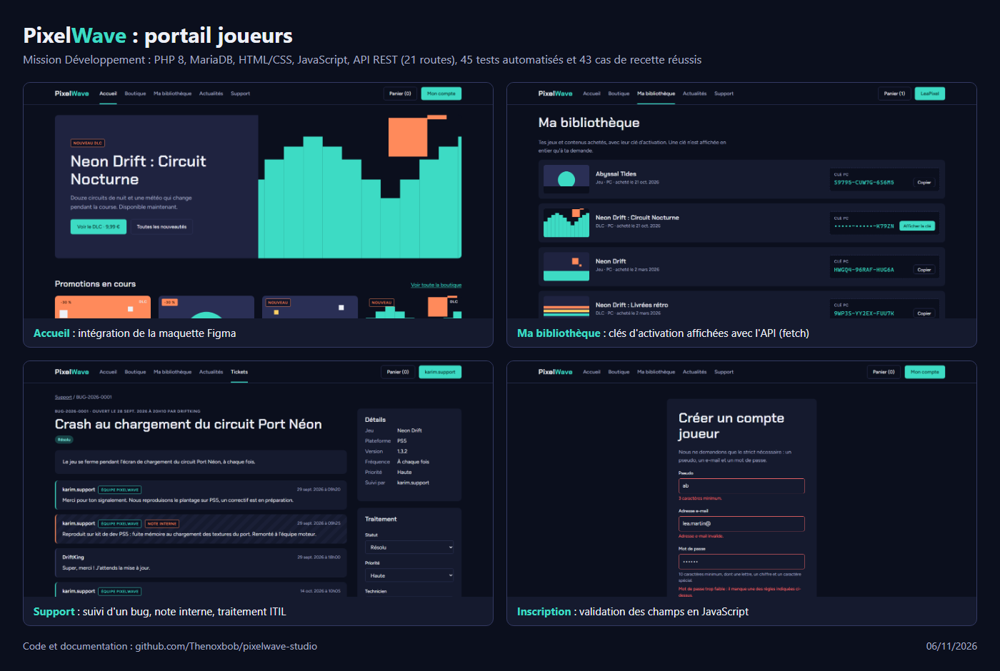

# Livrable 10 : preuve d'accomplissement

Voici la capture déposée sur Rynapse. Elle montre en une image ce que j'ai réalisé dans cette mission : l'accueil intégré à partir de la maquette Figma, la bibliothèque de clés qui utilise l'API, le suivi d'un bug côté support et la validation des formulaires en JavaScript.

Pour tout voir en détail, chaque livrable a sa page, listée sur la [page de la mission](README.md), et le code est dans le dossier [`portail/`](../../../portail/).
