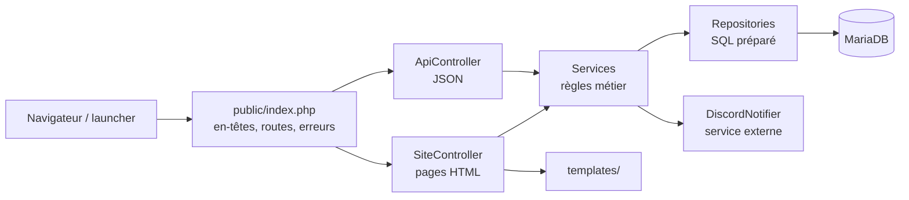

# Livrable 3 : architecture du backend

Le portail est une application **monolithique** : un seul programme PHP sert à la fois les pages HTML et l'API REST. J'ai quand même séparé le code en couches, pour que chaque partie ait un seul rôle.

## Les responsabilités

| Couche | Rôle | Fichiers |
|---|---|---|
| point d'entrée | reçoit toutes les requêtes, envoie les en-têtes de sécurité, choisit la route, transforme les erreurs en page ou en JSON | `public/index.php` |
| routage | associe une méthode et une URL à une fonction (`/boutique/{slug}`), renvoie 404 ou 405 | `src/Core/Router.php` |
| contrôleurs | lisent la requête, appellent le bon service, renvoient une vue ou du JSON | `src/Controller/SiteController.php`, `ApiController.php` |
| logique métier | les règles du portail : panier, commande, clés, tickets, comptes | `src/Service/*` |
| accès aux données | toutes les requêtes SQL, une classe par ressource | `src/Repository/*` |
| validation | vérifie les données reçues et collecte les erreurs par champ | `src/Core/Validator.php` |
| vues | le HTML des pages | `templates/` |

## Comment ça s'enchaîne



Le point important, c'est que le site et l'API appellent **les mêmes services**. Par exemple, la règle « on ne vend pas un produit déjà possédé » est écrite une seule fois dans `BoutiqueService`, et elle s'applique que l'achat passe par la page panier ou par `POST /api/v1/moi/commandes`.

## Arborescence

```
portail/
├── public/                  seul dossier accessible depuis le web
│   ├── index.php
│   └── assets/css, js
├── src/
│   ├── bootstrap.php        chargement des classes et de la configuration
│   ├── helpers.php          e(), prix(), date_fr(), longueur(), extrait()
│   ├── Core/                Auth, Config, Csrf, Database, HttpException, Request, Router, Session, Validator, View
│   ├── Repository/          Utilisateur, Produit, Panier, Bibliotheque, Commande, Ticket, Actualite, Jeton
│   ├── Service/             BoutiqueService, CompteService, TicketService, DiscordNotifier
│   └── Controller/          SiteController, ApiController
├── templates/               layout.php, une vue par page, partials/
├── config/                  config.example.php (config.php n'est pas versionné)
└── tests/                   unit/, integration/, api/
```

## Les points transverses

- **Configuration** : un fichier `config/config.php` (connexion à la base, URL, webhook Discord, réglages de sécurité), lu une fois par la classe `Config`. Il n'est pas sur GitHub ; `config.example.php` sert de modèle.
- **Erreurs** : une erreur prévue (donnée invalide, ressource introuvable, droits insuffisants) est une `HttpException` avec un code HTTP et un code d'erreur. `index.php` l'affiche comme une page d'erreur ou comme du JSON selon que la requête vient du site ou de l'API. Une erreur imprévue est notée dans le journal du serveur et l'utilisateur voit un message neutre.
- **Authentification** : `Auth` retrouve l'utilisateur à partir de la session (site) ou du jeton (API).
- **Autorisations** : `Auth::exiger(['support', 'admin'])` bloque une action selon le rôle, et les repositories filtrent toujours sur l'identifiant de l'utilisateur connecté.

## Pourquoi cette organisation

- Séparer le SQL de la logique métier et du HTTP rend le code plus facile à tester : les tests d'intégration appellent directement les services, sans passer par le navigateur.
- Le chargement automatique des classes (une classe par fichier, rangée selon son espace de noms) évite les `require` partout.
- Je n'ai pas pris de framework (Laravel, Symfony) pour garder un projet léger et bien comprendre chaque étape. L'organisation reste proche de celle d'un framework (routes, contrôleurs, services, repositories), donc une migration plus tard serait possible.
