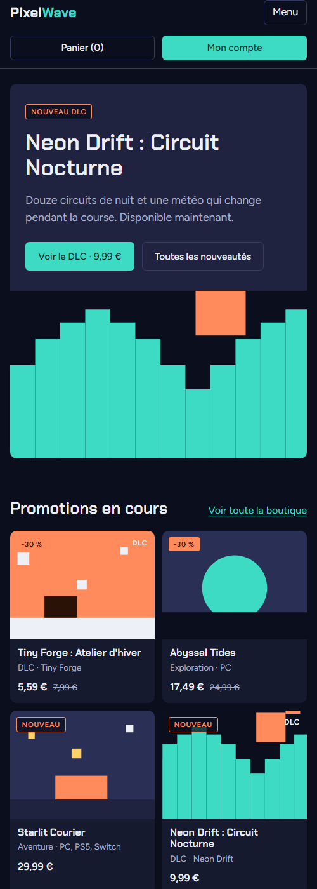

# Livrable 4 : intégration HTML et CSS

J'ai intégré les écrans de la maquette Figma (page « Maquettes et prototype ») en HTML et CSS. Le code est dans [`portail/templates/`](../../../portail/templates/) pour le HTML et dans [`style.css`](../../../portail/public/assets/css/style.css) pour le CSS.

## Les pages intégrées

Accueil, boutique, fiche produit, panier, ma bibliothèque, actualités et article, connexion, inscription, mon compte, support (liste, nouveau signalement, détail d'un ticket), aide, confidentialité, page d'erreur.

Toutes les pages utilisent le même gabarit (`layout.php`) : en-tête avec le menu, zone des messages, contenu de la page et pied de page.

## Respect de la charte graphique

Les couleurs de la charte sont déclarées une seule fois en variables CSS, en haut de `style.css` :

| Variable | Couleur | Utilisation |
|---|---|---|
| `--fond` | `#0b0f1d` | fond des pages |
| `--surface`, `--surface-2` | `#151a2e`, `#1f2340` | cartes, panneaux, bloc principal de l'accueil |
| `--teal` | `#3ddbc4` | boutons principaux, liens, page active |
| `--orange` | `#ff8a5b` | badges « Nouveau », promotions |
| `--texte`, `--texte-doux` | `#eef0f7`, `#a7adc6` | textes |

Les polices sont celles de la maquette : Chakra Petch pour les titres et Figtree pour le texte. Les illustrations des jeux sont des formes géométriques en SVG (`partials/visuel.php`), dans le même style que la maquette, pour ne pas dépendre d'images.

Les composants de la charte (bouton plein ou contour, badge, champ de formulaire, bloc clé) ont chacun leur classe CSS, réutilisée sur toutes les pages.

## Structure HTML

- Balises sémantiques : `header`, `nav`, `main`, `section`, `article`, `aside`, `footer`.
- Un seul `h1` par page, puis des `h2` et `h3` dans l'ordre.
- Les formulaires utilisent des `label` qui contiennent le champ, des types adaptés (`email`, `password`, `search`) et `autocomplete` pour aider les gestionnaires de mots de passe.
- Les tableaux (commandes, tickets) ont un `thead` avec des `th`.

## Adaptation aux écrans

- Les listes de produits et d'actualités sont des grilles CSS : 5, 4 ou 3 colonnes sur ordinateur, puis 2 ou 1 sur mobile.
- Sous 860 px, le menu se replie derrière un bouton « Menu », et les mises en page en deux colonnes (fiche produit, panier, ticket, compte) passent en une colonne.
- J'ai vérifié en 375 px de large : il n'y a pas de défilement horizontal.

## Accessibilité

- Lien « Aller au contenu » au début de la page pour la navigation au clavier.
- Le focus est toujours visible (contour teal).
- La page en cours est indiquée dans le menu avec `aria-current="page"`.
- Les champs en erreur ont `aria-invalid` et le message d'erreur leur est relié avec `aria-describedby`.
- Les textes ont un bon contraste sur le fond sombre (texte clair `#eef0f7` sur `#0b0f1d`).
- Les illustrations purement décoratives ont `aria-hidden="true"`.

## Vérification dans le navigateur

J'ai comparé chaque page avec la maquette dans Edge et Brave. Trois écarts visuels ont été trouvés et corrigés pendant la recette (anomalies ANO-02 à ANO-04 de la [mission Tests](../3-tests/anomalies.md)). Les captures des pages sont sur la [page de la mission](README.md#2-captures-décran).
