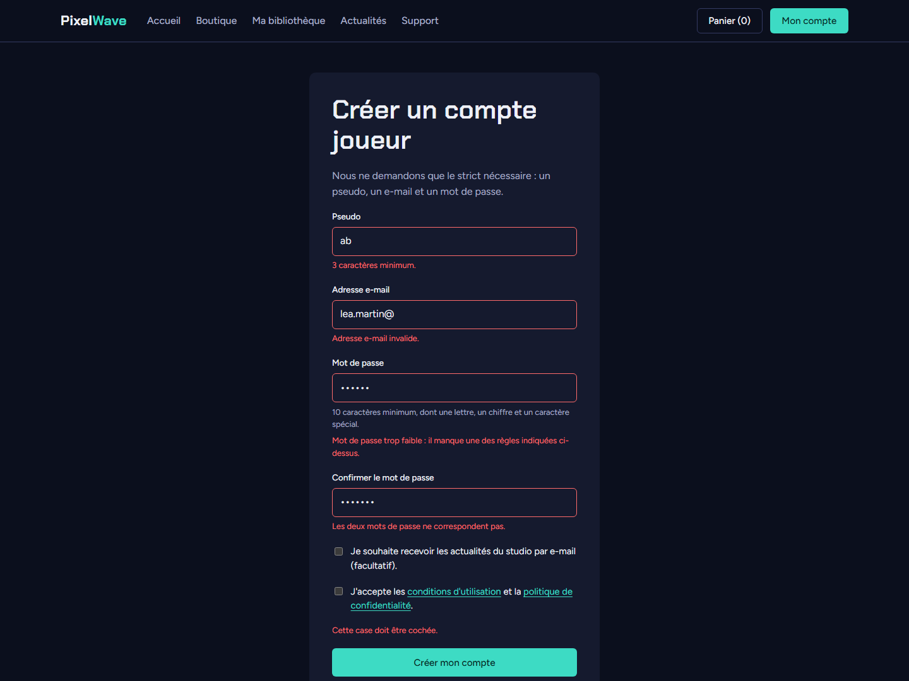

# Livrable 5 : JavaScript

Tout le JavaScript est dans un seul fichier, [`app.js`](../../../portail/public/assets/js/app.js), sans bibliothèque. Le site marche aussi sans JavaScript : le JS sert à rendre l'interface plus agréable, mais il ne remplace jamais les contrôles faits par le serveur.

## Les interactions

| Interaction | Page | Ce que fait le JavaScript |
|---|---|---|
| menu mobile | toutes | ouvre et ferme le menu sous 860 px, et met à jour `aria-expanded` |
| filtres automatiques | boutique | la liste se met à jour dès qu'on change la plateforme ou le tri ; pour la recherche, on attend 400 ms après la dernière touche |
| validation des formulaires | inscription, mot de passe, signalement de bug, réponse à un ticket | vérifie les champs avant l'envoi et affiche les erreurs sous chaque champ |
| compteur de caractères | signalement de bug | affiche « 13 / 5000 caractères (encore 7 au minimum) » pendant qu'on écrit |
| affichage d'une clé | bibliothèque | appelle l'API pour afficher la clé sans recharger la page (voir le [livrable 6](L6_communication_api.md)) |
| copier une clé | bibliothèque | copie la clé dans le presse-papiers et affiche « Copiée ! » |
| copier un jeton API | mon compte | un clic sur le jeton le copie |

## La validation des formulaires

Les formulaires concernés ont l'attribut `data-valider`. Les règles sont lues directement dans les attributs HTML du champ, donc je n'ai pas eu à les écrire deux fois :

- `required` : champ obligatoire, ou case à cocher (CGU) ;
- `minlength` et `maxlength` : longueur, comptée en caractères (les accents comptent pour un seul) ;
- `type="email"` : format d'une adresse e-mail ;
- `pattern` avec `data-message-motif` : format libre, par exemple les caractères autorisés dans un pseudo ;
- `data-regle="mot-de-passe"` : les mêmes règles que `Validator::motDePasseRobuste()` en PHP (10 caractères, une lettre, un chiffre, un caractère spécial) ;
- `data-confirme="mot_de_passe"` : la confirmation doit être identique.

Au moment de l'envoi, s'il y a une erreur, le formulaire n'est pas envoyé, chaque message s'affiche sous son champ et le curseur va sur le premier champ en erreur. Quand on quitte un champ, il est vérifié tout de suite. Et quand on corrige un champ en erreur, le message disparaît pendant la frappe.

## Organisation du code

Le code est découpé en petites fonctions réutilisables :

- `erreurDuChamp(champ, formulaire)` renvoie le message d'erreur d'un champ, ou une chaîne vide ;
- `afficherErreur(champ, message)` affiche ou enlève le message, au même endroit que les erreurs renvoyées par le serveur ;
- `validerFormulaire(formulaire)` vérifie tous les champs et place le curseur sur le premier en erreur ;
- `copier(texte, bouton)` gère le presse-papiers, avec une solution de secours si le navigateur refuse ;
- `revelerCle(bouton, bloc)` appelle l'API (livrable 6).

Les clics sont gérés par délégation (un seul écouteur sur `document`), ce qui marche aussi pour le bouton « Copier » ajouté après coup.

## Tests

J'ai testé dans le navigateur :

- inscription avec un pseudo de 2 lettres, un e-mail incomplet, un mot de passe faible, une confirmation différente et les CGU non cochées : le formulaire n'est pas envoyé et les 5 messages s'affichent ;
- puis avec des valeurs correctes : le formulaire part, le compte est créé et on arrive sur « Mon compte » ;
- compteur : avec « Le jeu plante », il affiche « 13 / 5000 caractères (encore 7 au minimum) », puis « 39 / 5000 caractères » avec une description plus longue.

La validation côté serveur reste en place : si on désactive le JavaScript, les mêmes erreurs sont renvoyées par PHP (tests `ValidatorTest` et `CompteTest`).
