# Mission Développement : le portail joueurs

Monde 2, étape 1. Technologies : HTML, CSS, JavaScript, PHP 8, MariaDB, Git.

Le code est dans [`portail/`](../../../portail/) et la base de données dans [`database/`](../../../database/).

## 1. Ce que j'ai développé

J'ai codé le portail joueurs de la maquette Figma, branché sur la base de données de la mission Conception Backend. Voici ce qui a été fait pour chaque besoin du cahier des charges :

| Besoin | Pages | Routes de l'API |
|---|---|---|
| créer et gérer un compte joueur | `/inscription`, `/connexion`, `/compte` (profil, mot de passe, newsletter, jetons) | `POST /auth/jetons`, `GET /moi` |
| voir ses jeux et ses clés | `/bibliotheque` (clé masquée, boutons « Afficher » et « Copier ») | `GET /moi/bibliotheque`, `POST /moi/cles/{id}/revelation` |
| utiliser la boutique | `/boutique` (filtres, tri, recherche), `/boutique/{slug}`, `/panier` | `/produits`, `/moi/panier`, `/moi/commandes` |
| lire les actualités | `/`, `/actualites`, `/actualites/{slug}` | `/actualites` |
| signaler un bug et suivre sa correction | `/support`, `/support/nouveau`, `/support/{reference}` | `/tickets` |
| traitement des tickets par le support (ITIL) | file des tickets, qualification, affectation, notes internes | `PATCH /tickets/{ref}` |
| communiquer avec un service externe | message envoyé sur Discord à chaque nouveau bug | |
| aide en ligne pour les joueurs | `/aide`, `/confidentialite` | |

Les trois parcours du prototype Figma marchent du début à la fin : acheter le DLC Circuit Nocturne, récupérer et copier sa clé, signaler un bug et suivre son ticket.

## 2. Captures d'écran

| Accueil (comme sur la maquette Figma) | Boutique |
|---|---|
| 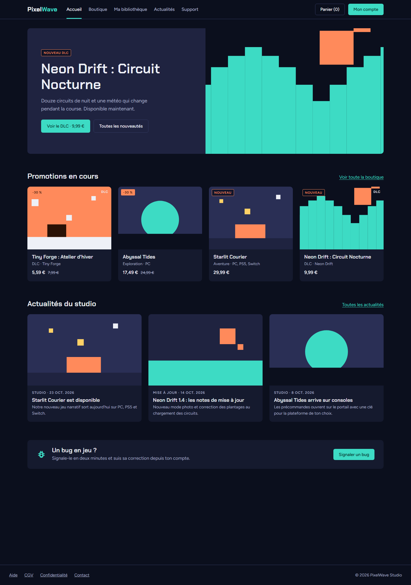 | 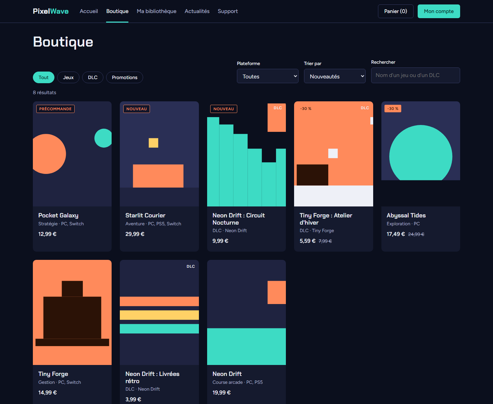 |

| Fiche produit | Ma bibliothèque |
|---|---|
| 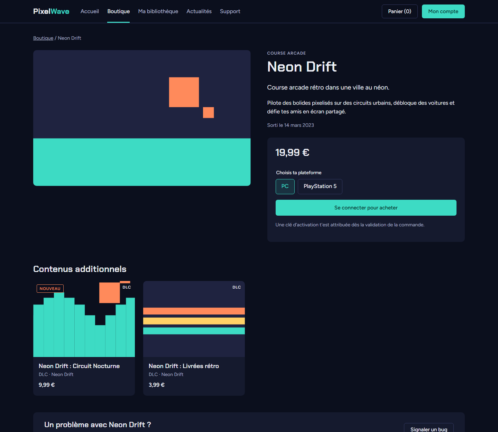 | 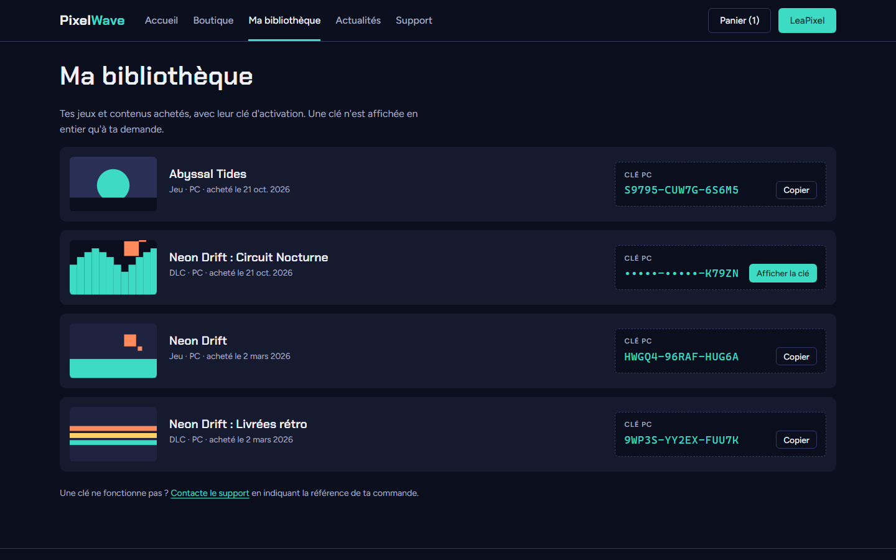 |

| Signaler un bug | Suivi d'un ticket côté joueur |
|---|---|
| 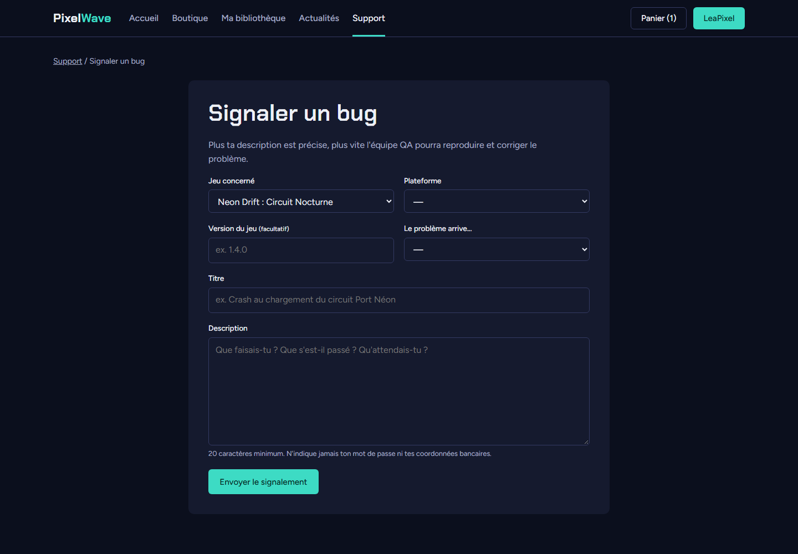 | 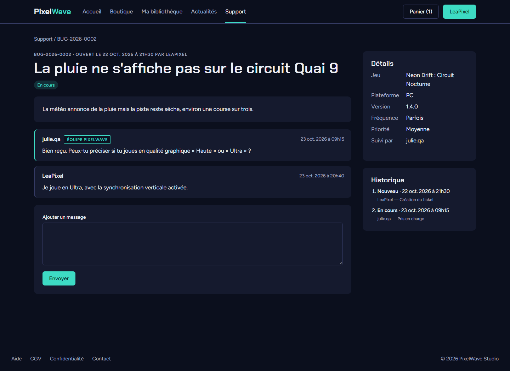 |

| File du support | Ticket côté support (note interne, traitement) |
|---|---|
| 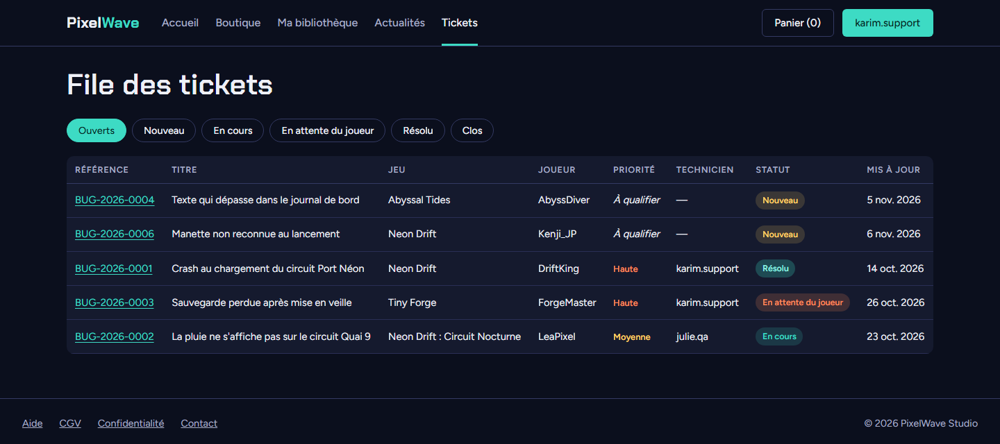 | 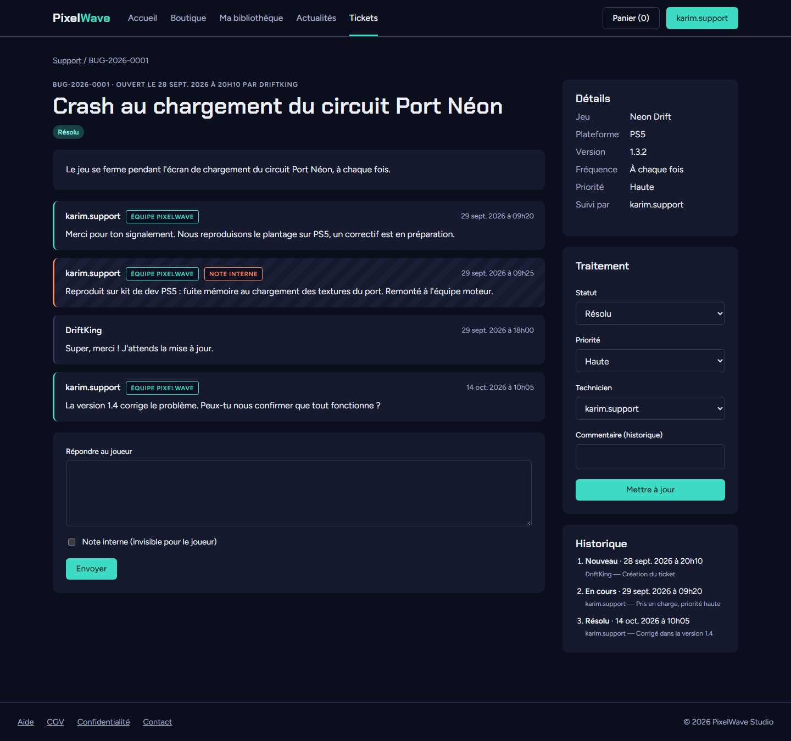 |

| Mon compte (commandes, jetons API) | Panier | Sur mobile |
|---|---|---|
| 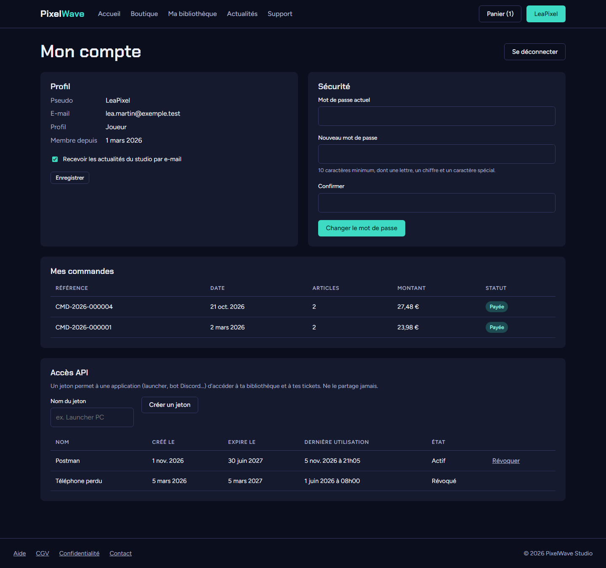 | 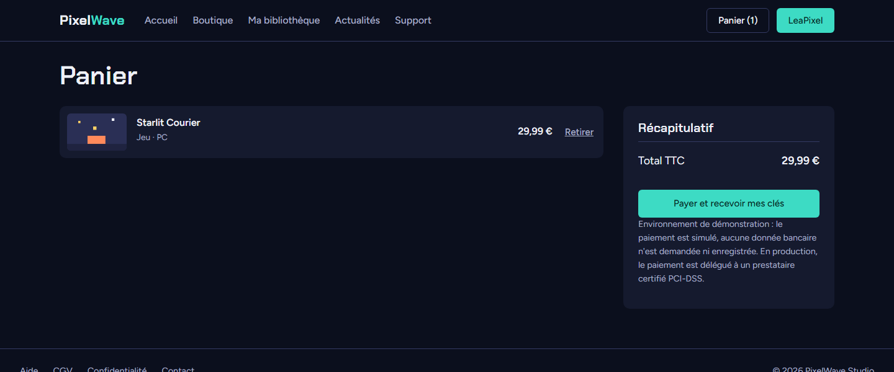 | 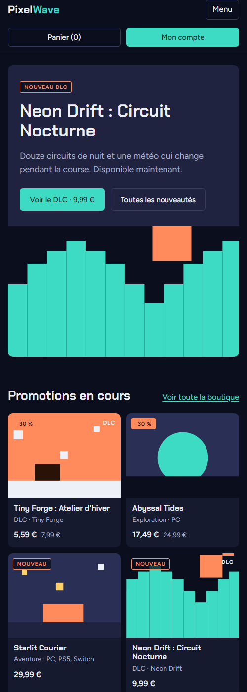 |

## 3. Organisation du code

Je n'ai pas utilisé de framework. J'ai préféré organiser le PHP moi-même pour bien comprendre chaque partie, et comme ça il n'y a aucune dépendance à installer.

```
portail/
├── public/                  dossier servi par Apache (le seul accessible depuis le web)
│   ├── index.php            point d'entrée : routes, en-têtes de sécurité, gestion des erreurs
│   └── assets/css, js       styles de la charte Figma et JavaScript
├── src/
│   ├── bootstrap.php        chargement des classes et de la configuration
│   ├── helpers.php          petites fonctions : e() pour échapper le HTML, prix(), date_fr()...
│   ├── Core/                Router, Request, View, Session, Csrf, Auth, Validator, Database
│   ├── Repository/          toutes les requêtes SQL, une classe par table principale
│   ├── Service/             les règles métier, utilisées à la fois par le site et par l'API
│   │   ├── BoutiqueService  panier, commande, attribution des clés
│   │   ├── CompteService    inscription, connexion, blocage après trop d'échecs
│   │   ├── TicketService    signalement, droits, étapes du ticket
│   │   └── DiscordNotifier  envoi du message sur Discord
│   └── Controller/
│       ├── SiteController   les pages HTML
│       └── ApiController    l'API REST en JSON
├── templates/               les vues (un gabarit commun et une vue par page)
├── config/config.example.php  modèle de configuration (le vrai config.php n'est pas sur GitHub)
└── tests/                   tests unitaires, d'intégration et recette de l'API
```

Le fonctionnement est toujours le même : le contrôleur reçoit la requête, il appelle un service qui applique les règles métier, le service passe par un repository pour lire ou écrire en base, et à la fin on renvoie soit une vue HTML, soit du JSON. Le site et l'API utilisent les mêmes services, donc une règle comme « pas de clé pour une plateforme qui n'est pas proposée » n'est écrite qu'à un seul endroit.

### Exemple : ce qui se passe quand on valide une commande

Que ce soit par `POST /panier/valider` ou par `POST /api/v1/moi/commandes`, on arrive dans `BoutiqueService::validerCommande()` :

1. on ouvre une transaction ;
2. on lit le panier avec `FOR UPDATE` pour le verrouiller ;
3. on crée la commande, puis pour chaque article on cherche une clé libre (`id_ligne IS NULL`) avec `FOR UPDATE`, on crée la ligne de commande au prix du jour et on attribue la clé ;
4. s'il manque une clé, on annule tout (`ROLLBACK`) et on renvoie une erreur 409, donc rien n'est enregistré ;
5. sinon on vide le panier et on valide la transaction (`COMMIT`).

## 4. Sécurité

Je me suis appuyé sur le Top 10 de l'OWASP pour savoir quoi protéger :

| Risque | Ce que j'ai fait | Où |
|---|---|---|
| injection SQL | requêtes préparées avec PDO partout, aucune requête construite avec ce que tape l'utilisateur ; les caractères `%` et `_` sont neutralisés dans la recherche | `Repository/*` |
| XSS | tout ce qui est affiché passe par `e()` (`htmlspecialchars`) ; en-tête Content-Security-Policy qui n'autorise que nos propres scripts | `helpers.php`, `index.php` |
| CSRF | un jeton aléatoire par session, vérifié sur tous les formulaires ; en-tête `X-CSRF-Token` pour les appels à l'API faits avec le cookie ; cookie en `SameSite=Lax` | `Core/Csrf.php` |
| mots de passe | `password_hash` et `password_verify` (bcrypt), mise à jour automatique du hachage, 10 caractères minimum | `CompteService` |
| force brute | blocage de 15 minutes après 5 échecs sur un e-mail ou 20 depuis une IP, avec le journal `tentative_connexion` | `CompteService` |
| deviner les e-mails inscrits | même message d'erreur que le compte existe ou pas, et le mot de passe est vérifié dans les deux cas pour que le temps de réponse soit le même | `CompteService::authentifier` |
| vol de session | cookie `HttpOnly`, `Secure` en HTTPS, mode strict, nouvel identifiant de session à la connexion | `Core/Session.php` |
| accès aux données des autres | chaque requête filtre sur l'utilisateur connecté (`WHERE id_utilisateur = ?`), erreur 404 si la ressource est à quelqu'un d'autre, rôles vérifiés côté serveur | services, repositories |
| fuite de données par l'API | les réponses sont construites champ par champ, donc jamais d'empreinte, de clé non affichée ou de note interne | `ApiController::formater*` |
| jetons d'API | générés avec `random_bytes`, stockés en SHA-256, avec une date d'expiration et la possibilité de les révoquer | `JetonRepository` |
| redirection vers un autre site | les redirections n'acceptent que des chemins internes au portail | `Core/View.php` |
| clickjacking, type MIME | en-têtes `X-Frame-Options: DENY`, `X-Content-Type-Options: nosniff` et `Referrer-Policy` | `index.php` |
| messages d'erreur trop bavards | en production, le visiteur voit un message neutre et le détail part dans le journal du serveur | `index.php` |
| droits sur la base | le compte MariaDB de l'appli n'a que `SELECT`, `INSERT`, `UPDATE` et `DELETE` | `infra/srv-portail/install.sh` |
| données bancaires | jamais reçues ni stockées (paiement simulé, prestataire certifié prévu) | |

Chacune de ces protections est vérifiée par un test, voir la [mission Tests](../3-tests/README.md) (cas SEC-01 à SEC-11).

## 5. Accessibilité et mobile

- La mise en page s'adapte à l'écran (grilles CSS, menu qui se replie sous 860 px). Je l'ai testée en 375 px de large, sans défilement horizontal.
- Il y a un lien « Aller au contenu » pour la navigation au clavier, la page en cours est indiquée dans le menu (`aria-current`), les champs en erreur sont signalés (`aria-invalid` avec le message associé) et le focus reste visible.
- Le site marche aussi sans JavaScript. Le JS sert seulement à améliorer le confort : filtres qui s'appliquent tout seuls, affichage de la clé sans recharger, bouton copier.

## 6. Git

- Le projet est sur GitHub, sur la branche `main`, avec un commit par mission et des messages clairs.
- Le `.gitignore` exclut `portail/config/config.php` et les configurations de test, parce qu'ils contiennent des mots de passe, ainsi que les fichiers générés.
- Aucun secret n'est sur GitHub : `config.example.php` sert de modèle, et le script d'installation du serveur génère lui-même un mot de passe aléatoire pour la base.

## 7. Lancer le portail sur son PC

Il faut PHP 8.2 ou plus (avec l'extension `pdo_mysql`) et MariaDB 10.11 ou plus.

```bash
mariadb -u root -p < database/01_creation.sql
mariadb -u root -p < database/02_jeu_de_donnees.sql
cp portail/config/config.example.php portail/config/config.php   # puis remplir la connexion à la base
php -S 127.0.0.1:8080 -t portail/public portail/public/index.php
```

Ensuite on ouvre http://127.0.0.1:8080. Les comptes de démonstration sont dans [`database/README.md`](../../../database/README.md).

Pour l'installation sur le serveur, voir la [mission Infrastructure](../4-infrastructure/README.md).

## 8. Limites et améliorations prévues

- Le paiement est simulé. Il faudra brancher un vrai prestataire (Stripe ou PayPal), d'abord en mode test.
- On ne peut pas encore réinitialiser son mot de passe par e-mail. Il faudra envoyer un lien à usage unique, avec le serveur mail du studio.
- Il n'y a pas d'interface d'administration du catalogue : pour l'instant les produits, les promos et les clés s'ajoutent en SQL.
- Les tickets du portail ne sont pas encore synchronisés avec GLPI. On pourra le faire avec l'API REST de GLPI.
- Les polices sont chargées depuis Google Fonts. Pour le RGPD, ce serait mieux de les héberger sur notre serveur.
