# Documentation de la mise en place des tests

**Projet :** PixelWave Studio, portail joueurs
**Mission :** Monde 2, Mise en place des tests (compétence C16)
**Auteur :** Ilhan Dulieu, BTS SIO SISR 2e année, EFREI
**Version testée :** portail 1.0, dépôt https://github.com/Thenoxbob/pixelwave-studio (branche `main`)
**Date de la campagne :** 6 novembre 2026

Ce document explique ce que j'ai testé sur le portail joueurs, comment, avec quels résultats, et comment rejouer tous les tests. Il doit suffire à quelqu'un qui ne connaît pas le projet.

## Sommaire

1. Stratégie de test
2. Périmètre et critères de réussite
3. Cahier de recette
4. Tests automatisés et comment les rejouer
5. Exécution de la recette
6. Suivi des anomalies
7. Procès-verbal de recette

## 1. Stratégie de test

Le portail est composé de plusieurs parties. Pour chacune, j'ai choisi le type de test le plus adapté :

| Composant | Type de test | Ce qu'on vérifie | Outil |
|---|---|---|---|
| fonctions PHP isolées (validation, routage, affichage) | tests unitaires | une fonction donne le bon résultat pour une entrée donnée | `portail/tests/unit` (format PHPUnit) |
| services PHP + base MariaDB (commande, clés, comptes, tickets) | tests d'intégration | le code et la vraie base fonctionnent ensemble, contraintes comprises | `portail/tests/integration` |
| API REST (21 routes) | tests fonctionnels « boîte noire » | chaque route répond avec le bon code et le bon contenu, y compris en cas d'erreur | collection Postman + script `recette_api.php` |
| règles de saisie | jeux d'essai | valeurs valides, limites et invalides acceptées ou refusées comme prévu | `portail/tests/jeux_essai.php` |
| sécurité | tests de sécurité | CSRF, XSS, injection SQL, force brute, cookie, en-têtes, jetons | script `recette_api.php` (cas SEC) |
| interface web (parcours complets) | recette (tests d'acceptation) | le portail répond au cahier des charges du point de vue du joueur et du support | cahier de recette, exécuté dans le navigateur |
| ensemble après une correction | non-régression | une correction n'a rien cassé ailleurs | relance de toutes les campagnes automatiques |

Je n'ai pas fait de test de charge dans cette campagne. Il sera à faire avant la mise en production réelle (outil k6 ou JMeter). Le test utilisateur a déjà été fait sur le prototype Figma au Monde 1.

## 2. Périmètre et critères de réussite

### Ce qui est testé

- les comptes : inscription, connexion, déconnexion, blocage après trop d'échecs, compte désactivé ;
- la boutique : catalogue, filtres, recherche, prix remisés, panier, commande et attribution des clés ;
- la bibliothèque : affichage des jeux, affichage et copie d'une clé, cloisonnement entre joueurs ;
- le support : signalement d'un bug, échanges, qualification et affectation par le support, notes internes ;
- l'API REST : toutes les routes, cas normaux et cas d'erreur ;
- la sécurité des services exposés sur Internet.

### Ce qui n'est pas testé

- le paiement réel (il est simulé dans cette version) ;
- l'envoi réel du message Discord (pas de salon de test disponible) ;
- la tenue en charge ;
- l'installation sur les serveurs Debian (elle a ses propres scripts de validation dans la mission Infrastructure).

### Critères d'acceptation

La recette est réussie si :

1. tous les scénarios du cahier de recette sont conformes ;
2. tous les tests automatiques passent (unitaires, intégration, API, sécurité, jeux d'essai, collection Postman) ;
3. il ne reste aucune anomalie bloquante ou majeure ouverte ;
4. les anomalies mineures restantes, s'il y en a, sont notées dans le PV comme réserves.

Une anomalie est **bloquante** si une fonctionnalité ne marche plus du tout, **majeure** si elle marche mal mais qu'on peut contourner le problème, **mineure** si c'est un souci visuel ou de confort.

## 3. Cahier de recette

### Environnement de test

- PC Windows 11, PHP 8.4 (serveur intégré `php -S`), MariaDB 11.4.4, navigateurs Edge et Brave.
- Base remise à zéro avant la campagne avec `database/01_creation.sql` puis `database/02_jeu_de_donnees.sql`.

### Comptes de test

Tous ces comptes sont fictifs et ont le mot de passe `Pixelwave!2026` (voir `database/README.md`).

| Compte | E-mail | Rôle | Particularité |
|---|---|---|---|
| LeaPixel | lea.martin@exemple.test | joueur | 4 jeux, une clé pas encore affichée |
| DriftKing | tom.durand@exemple.test | joueur | une commande remboursée |
| NoobSaibot | yanis.leroy@exemple.test | joueur | aucun achat |
| OldTimer | paul.roux@exemple.test | joueur | compte désactivé |
| karim.support | karim@pixelwave.test | support | traite les tickets |

### Les scénarios

Priorité : **P1** = fonction indispensable à la mise en ligne, **P2** = importante, **P3** = confort.

| ID | Prio | Exigence | Étapes et données | Résultat attendu |
|---|---|---|---|---|
| REC-01 | P1 | créer un compte | `/inscription` avec `NouvelleRecrue`, un e-mail valide, `Un-Mot2Passe!`, CGU cochées | compte créé, connecté, mot de passe haché en base |
| REC-02 | P1 | contrôler les saisies | pseudo `LeaPixel` (pris), e-mail `lea.martin@`, mot de passe `azerty`, confirmation différente | erreurs sous chaque champ, rien n'est créé |
| REC-03 | P1 | se connecter | `lea.martin@exemple.test` + bon mot de passe | message « Bon retour, LeaPixel ! », page « Mon compte » |
| REC-04 | P2 | ne pas révéler les comptes | mauvais mot de passe, puis e-mail inconnu | même message dans les deux cas |
| REC-05 | P1 | bloquer la force brute | 5 mauvais mots de passe pour `tom.durand@exemple.test`, puis le bon | « Trop de tentatives de connexion. Réessaie dans 15 minutes. » |
| REC-06 | P2 | compte désactivé | connexion avec `paul.roux@exemple.test` | refusée |
| REC-07 | P1 | pages privées | ouvrir `/bibliotheque` sans être connecté | renvoi vers la connexion, puis retour sur la page |
| REC-08 | P1 | voir la boutique | ouvrir `/boutique` | 8 produits, le produit retiré n'apparaît pas, badges promo/nouveau/précommande |
| REC-09 | P2 | filtrer et chercher | « Promotions », puis recherche « neon » | 2 produits (5,59 € et 17,49 €), puis 3 « Neon Drift » |
| REC-10 | P1 | acheter | NoobSaibot achète Abyssal Tides sur PC | commande créée à 17,49 €, une clé attribuée, jeu dans la bibliothèque |
| REC-11 | P1 | rupture de stock | fiche Starlit Courier | Switch grisé « Rupture », ajout impossible (409) |
| REC-12 | P2 | pas de double achat | LeaPixel ouvre Neon Drift | PC grisé « Déjà possédé » |
| REC-13 | P1 | commande tout ou rien | panier de 2 articles, la dernière clé du 2e est vendue entre-temps | aucune commande créée, aucune clé utilisée |
| REC-14 | P1 | voir ses clés | LeaPixel ouvre `/bibliotheque` | 4 produits, la clé du Circuit Nocturne est masquée |
| REC-15 | P1 | afficher et copier une clé | « Afficher la clé » puis « Copier » | `3V835-NUTAC-K79ZN` s'affiche sans recharger, bouton « Copier » |
| REC-16 | P1 | clés d'un autre joueur | LeaPixel demande la clé n°3 (à DriftKing) | 404, aucune information |
| REC-17 | P2 | commande remboursée | DriftKing ouvre sa bibliothèque | seul Neon Drift apparaît |
| REC-18 | P1 | signaler un bug | LeaPixel : Circuit Nocturne, PC, 1.4.0, titre + description | référence `BUG-2026-xxxx`, statut Nouveau, historique créé |
| REC-19 | P2 | contrôler le signalement | titre « Bug », description « ça plante », plateforme inconnue | erreurs, aucun ticket |
| REC-20 | P1 | qualifier un ticket (ITIL) | karim.support : En cours, Moyenne, julie.qa | ticket mis à jour, ligne ajoutée à l'historique |
| REC-21 | P2 | échanges joueur / support | le joueur répond à un ticket « En attente du joueur » | message ajouté, ticket repasse « En cours » |
| REC-22 | P1 | cloisonner les tickets | LeaPixel ouvre `/support/BUG-2026-0001` (ticket de DriftKing) | 404 ; le support voit le ticket et la note interne |
| REC-23 | P2 | droits sur les tickets | LeaPixel envoie `PATCH /api/v1/tickets/{ref}` | 403 |
| REC-24 | P1 | sécurité | sans jeton CSRF ; script dans un titre ; `' OR 1=1 -- ` dans la recherche ; en-têtes | 403 ; script affiché comme du texte ; 0 résultat ; CSP, X-Frame-Options, cookie HttpOnly |

### Jeux d'essai

Pour les champs avec des règles, j'ai prévu une valeur valide, les valeurs limites et des valeurs invalides :

| Donnée | Règle | Valide | Limites (acceptées) | Invalides (refusées) |
|---|---|---|---|---|
| pseudo | 3 à 30 caractères, lettres, chiffres, `.`, `-`, `_` | `LeaPixel` | `abc` (3), 30 caractères | `ab` (2), 31 caractères, `Lea Pixel` (espace) |
| mot de passe | 10 caractères min, une lettre, un chiffre, un caractère spécial | `Un-Mot2Passe!` | `Abcdefgh1!` (exactement 10) | `Abcdefg1!` (9), `motdepasse123`, `1234567890!!` |
| e-mail | format valide, pas déjà utilisé | `lea.martin@exemple.test` | | `lea.martin@`, un e-mail déjà inscrit |
| titre d'un ticket | 5 à 150 caractères | | `Crash` (5), 150 caractères | `Bug` (3), 151 caractères |
| description d'un ticket | 20 caractères min (les accents comptent pour un) | | `Écran noir au départ` (20) | `Écran noir au dépar` (19) |
| version du jeu | lettres, chiffres, points, tirets | `1.4.0` | | `<b>1</b>` |
| plateforme à l'achat | une plateforme où le produit est vendu et en stock | Abyssal Tides sur PC | Livrées rétro sur PS5 (dernière clé) | Abyssal Tides sur PS5, Starlit Courier sur Switch (0 clé) |
| réduction (base) | entre 1 et 90 % | 30 % | 1 %, 90 % | 95 % (refusé par la contrainte `CHECK`) |
| connexion | blocage après 5 échecs en 15 minutes | bon mot de passe | 4 échecs puis le bon : accepté | 5 échecs puis le bon : bloqué |

## 4. Tests automatisés et comment les rejouer

### 4.1 Préparer le poste

Il faut :

- PHP 8.2 ou plus avec l'extension `pdo_mysql` ;
- MariaDB 10.11 ou plus (ou MySQL 8) ;
- Git ;
- pour l'API : Postman (ou Newman), ou Python 3 pour le script de remplacement.

Étapes :

```bash
# 1. récupérer le projet
git clone https://github.com/Thenoxbob/pixelwave-studio.git
cd pixelwave-studio

# 2. créer la base et le jeu de données de test
mariadb -u root -p < database/01_creation.sql
mariadb -u root -p < database/02_jeu_de_donnees.sql

# 3. configurer le portail (renseigner l'utilisateur et le mot de passe MariaDB)
cp portail/config/config.example.php portail/config/config.php

# 4. configurer les tests : base « pixelwave_test » et un compte MariaDB qui peut la créer
cp portail/tests/config.test.example.php portail/tests/config.test.php

# 5. démarrer le portail (laisser ce terminal ouvert)
php -S 127.0.0.1:8080 -t portail/public portail/public/index.php
```

Dans `config.php`, mettre `'env' => 'dev'` pour voir les erreurs pendant les tests. Le portail répond alors sur http://127.0.0.1:8080.

### 4.2 Tests unitaires

Ils sont dans `portail/tests/unit` : 17 tests dans 3 classes.

- `ValidatorTest` (8 tests) : champs obligatoires, e-mail, longueur avec accents, règles du mot de passe, valeurs autorisées, identifiants, détail des erreurs.
- `RouterTest` (4 tests) : paramètres dans l'URL, choix selon la méthode, 404, 405 avec les méthodes autorisées.
- `HelpersTest` (5 tests) : échappement HTML (XSS), format des prix et des dates, extrait de texte, empreinte des jetons.

Exemple commenté :

```php
public function testPolitiqueDeMotDePasse(): void
{
    // chaque ligne teste une règle du mot de passe : un cas refusé par règle manquante
    $this->assertFalse(Validator::motDePasseRobuste('court1!'), 'trop court');
    $this->assertFalse(Validator::motDePasseRobuste('motdepasse123'), 'sans caractère spécial');
    $this->assertFalse(Validator::motDePasseRobuste('1234567890!!'), 'sans lettre');
    // et des cas acceptés, dont un avec des lettres accentuées
    $this->assertTrue(Validator::motDePasseRobuste('Pixelwave!2026'));
    $this->assertTrue(Validator::motDePasseRobuste('été-à-la-mer-42'));
}
```

### 4.3 Tests d'intégration

Ils sont dans `portail/tests/integration` : 28 tests dans 3 classes (`BoutiqueTest`, `CompteTest`, `TicketTest`). Avant **chaque** test, la base `pixelwave_test` est supprimée puis recréée avec les deux scripts SQL, donc chaque test part exactement des mêmes données et les tests ne dépendent pas les uns des autres.

Exemple commenté, le test de la commande « tout ou rien » :

```php
public function testCommandeAnnuleeEntierementSiUneCleManque(): void
{
    $this->boutique->ajouterAuPanier(self::NOOB, 1, 'PC');      // Neon Drift PC
    $this->boutique->ajouterAuPanier(self::NOOB, 8, 'PS5');     // Livrées rétro PS5 : dernière clé
    // on simule un autre joueur qui achète cette dernière clé avant le paiement
    BaseDeTest::pdo()->exec('DELETE FROM cle_activation WHERE id_produit = 8 AND id_plateforme = 2 AND id_ligne IS NULL');

    // la validation doit échouer avec une erreur 409...
    $this->assertSame('409 stock_epuise', $this->codeErreur(fn() => $this->boutique->validerCommande(self::NOOB)));
    // ...et rien ne doit avoir été enregistré : pas de commande, panier intact
    $this->assertSame(0, (int) BaseDeTest::valeur('SELECT COUNT(*) FROM commande WHERE id_utilisateur = ?', [self::NOOB]));
    $this->assertSame(2, (new PanierRepository())->compter(self::NOOB));
}
```

**Lancer les tests unitaires et d'intégration :**

```bash
cd portail
php tests/run.php              # les deux suites
php tests/run.php unit         # seulement les tests unitaires
```

Le fichier `tests/run.php` permet de lancer les tests sans installer Composer. Les fichiers de test utilisent le format de PHPUnit, donc avec Composer on peut aussi lancer `composer require --dev phpunit/phpunit` puis `vendor/bin/phpunit` (configuration dans `phpunit.xml`).

Résultat attendu : `45 tests, 45 réussis, 0 échecs, 0 erreurs`.

### 4.4 Jeux d'essai

```bash
cd portail
php tests/jeux_essai.php
```

Le script passe les valeurs du tableau de la partie 3 dans les mêmes règles que le portail et affiche, pour chacune, si elle est acceptée ou refusée. Résultat attendu : `21/21 jeux d'essai conformes`.

### 4.5 Collection Postman (intégration de l'API)

La collection `api/pixelwave_api.postman_collection.json` contient 30 requêtes rangées en 5 dossiers (public, authentification, espace joueur, tickets, fin de session). Chaque requête a un script de test qui vérifie le code de statut et une partie de la réponse. Les requêtes s'enchaînent : la création d'un jeton support enregistre ce jeton dans une variable, et la création d'un ticket enregistre sa référence pour les requêtes suivantes.

Exemple de script de test d'une requête (« Créer un jeton support ») :

```js
pm.test('Statut 201', () => pm.response.to.have.status(201));
// on garde le jeton pour les requêtes réservées au support
pm.collectionVariables.set('jetonSupport', pm.response.json().jeton);
pm.test('Rôle support', () => pm.expect(pm.response.json().utilisateur.role).to.eql('support'));
```

**Rejouer la collection :**

1. remettre la base à zéro (les deux scripts SQL de l'étape 4.1) ;
2. dans Postman : Import, choisir `api/pixelwave_api.postman_collection.json` et `api/pixelwave_local.postman_environment.json`, sélectionner l'environnement « PixelWave · local » ;
3. clic droit sur la collection, Run collection, puis Run : les 30 requêtes doivent être vertes.

En ligne de commande avec Newman : `npx newman run api/pixelwave_api.postman_collection.json -e api/pixelwave_local.postman_environment.json`.

Sur mon poste, Postman n'était pas installé. J'ai donc rejoué la collection avec un petit script qui lit le même fichier, envoie les 30 requêtes dans l'ordre et compare les codes de statut : `python api/rejouer_collection.py`. Résultat attendu : `30 OK, 0 KO`.

### 4.6 Recette automatique de l'API et de la sécurité

Le portail doit être démarré (étape 4.1, point 5).

```bash
cd portail
cp tests/config.test.php tests/config.recette.php   # puis remplacer pixelwave_test par pixelwave
PIXELWAVE_CONFIG=tests/config.recette.php php tests/api/recette_api.php http://127.0.0.1:8080 --reinitialiser
```

Sous PowerShell, la variable s'écrit `$env:PIXELWAVE_CONFIG="tests/config.recette.php"` sur la ligne d'avant.

L'option `--reinitialiser` recrée la base avant de commencer. Le script envoie de vraies requêtes HTTP : 32 cas sur l'API (API-01 à API-32) et 11 cas de sécurité (SEC-01 à SEC-11). Il écrit aussi le tableau des résultats dans `tests/api/resultats.md`. Résultat attendu : `43/43 cas conformes`.

Exemple commenté d'un cas de sécurité (XSS) :

```php
// le titre du ticket créé plus haut contient <script>alert("xss")</script> :
// la page du ticket doit l'afficher comme du texte, sans jamais l'exécuter
cas('SEC-04', 'Contenu saisi échappé à l\'affichage (XSS)', 200, http('GET', "/support/$refLea", ['cookie' => $cookie]),
    fn($r) => str_contains($r['corps'], '&lt;script&gt;alert') && !str_contains($r['corps'], '<script>alert'));
```

## 5. Exécution de la recette

### 5.1 Résultats des campagnes automatiques

| Campagne | Résultat | Preuve |
|---|---|---|
| tests unitaires | 17 / 17 | capture AUTO-1 |
| tests d'intégration | 28 / 28 | capture AUTO-1 |
| recette de l'API | 32 / 32 | capture AUTO-2 |
| tests de sécurité | 11 / 11 | capture AUTO-2 |
| collection Postman | 30 / 30 | capture AUTO-3 |
| jeux d'essai | 21 / 21 | capture AUTO-4 |

**AUTO-1 : tests unitaires et d'intégration**

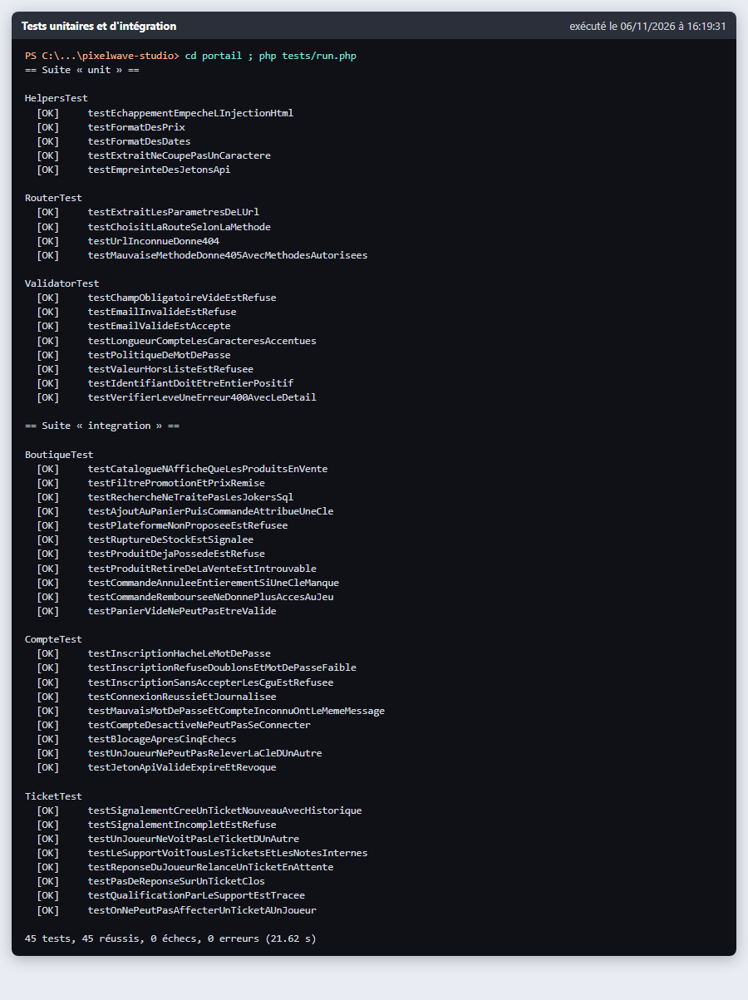

**AUTO-2 : recette de l'API et de la sécurité**

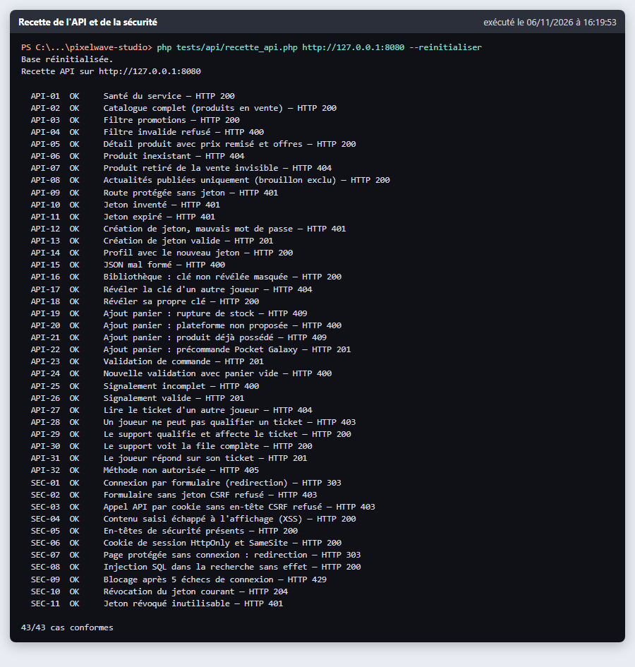

**AUTO-3 : collection Postman rejouée**

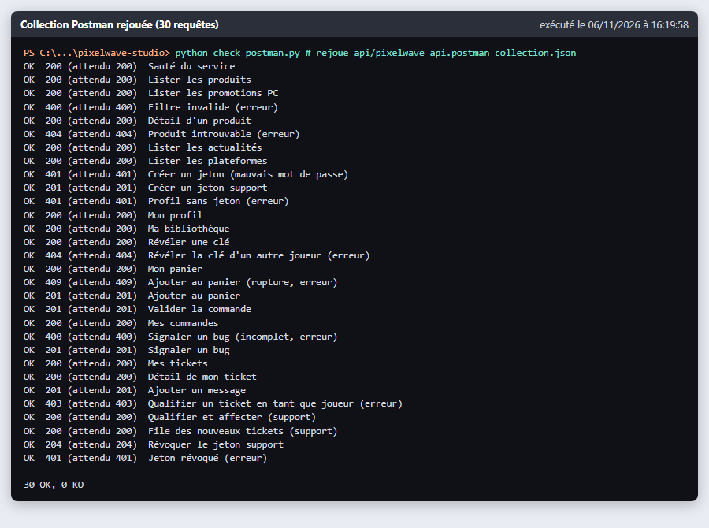

**AUTO-4 : jeux d'essai**

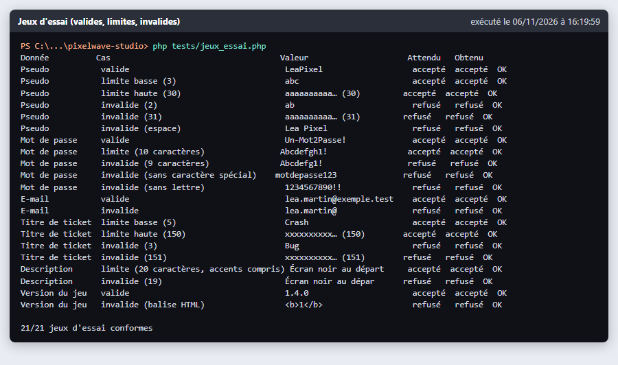

### 5.2 Résultats par scénario

« main » veut dire testé à la main dans le navigateur, « auto » vérifié par un test automatique.

| ID | Résultat obtenu | Comment | Statut | Preuve |
|---|---|---|---|---|
| REC-01 | compte créé, empreinte bcrypt en base, e-mail en minuscules | auto (`testInscriptionHacheLeMotDePasse`) | conforme | AUTO-1 |
| REC-02 | 5 erreurs affichées sous les champs, formulaire non envoyé ; le serveur refuse aussi | main + auto | conforme | capture REC-02 |
| REC-03 | « Bon retour, LeaPixel ! » puis « Mon compte » | main + auto (SEC-01) | conforme | AUTO-2 |
| REC-04 | même message « E-mail ou mot de passe incorrect. » | auto | conforme | AUTO-1 |
| REC-05 | « Trop de tentatives de connexion. Réessaie dans 15 minutes. » | main + auto (SEC-09) | conforme | capture REC-05 |
| REC-06 | connexion refusée | auto | conforme | AUTO-1 |
| REC-07 | renvoi vers `/connexion?retour=/bibliotheque`, puis retour | main + auto (SEC-07) | conforme | AUTO-2 |
| REC-08 | 8 produits, badges corrects | main + auto (API-02) | conforme | AUTO-2 |
| REC-09 | 2 promotions puis 3 résultats | main + auto (API-03) | conforme | AUTO-2 |
| REC-10 | commande CMD-2026-000010 à 17,49 €, Abyssal Tides dans la bibliothèque | main + auto | conforme | capture REC-10 |
| REC-11 | Switch grisé « Rupture » ; 409 par l'API | main + auto (API-19) | conforme | capture REC-11 |
| REC-12 | PC grisé « Déjà possédé » ; 409 par l'API | main + auto (API-21) | conforme | AUTO-2 |
| REC-13 | aucune commande, panier intact | auto | conforme | AUTO-1 |
| REC-14 | 4 produits, clé masquée `•••••-•••••-K79ZN` | main + auto (API-16) | conforme | AUTO-2 |
| REC-15 | clé affichée sans recharger, bouton « Copier » | main + auto (API-18) | conforme | capture REC-15 |
| REC-16 | 404 | auto (API-17) | conforme | AUTO-2 |
| REC-17 | seul Neon Drift | auto | conforme | AUTO-1 |
| REC-18 | BUG-2026-0007 créé au statut Nouveau | main + auto (API-26) | conforme | capture REC-18 |
| REC-19 | erreurs par champ, aucun ticket | auto (API-25) | conforme | AUTO-2 |
| REC-20 | En cours, Moyenne, julie.qa, historique à jour | main + auto (API-29) | conforme | capture REC-20 |
| REC-21 | message ajouté, ticket repassé En cours | auto | conforme | AUTO-1 |
| REC-22 | 404 pour le joueur ; le support voit 4 messages dont la note interne | main + auto | conforme | capture REC-22 |
| REC-23 | 403 `acces_refuse` | auto (API-28) | conforme | AUTO-2 |
| REC-24 | 403, 403, texte échappé, 0 résultat, en-têtes présents | auto (SEC-02 à SEC-08) | conforme | AUTO-2 |

**Bilan : 24 scénarios sur 24 conformes.**

### 5.3 Captures de la recette dans le navigateur

Chaque capture porte en bas à droite la date et l'heure où elle a été prise.

**REC-02 : saisies invalides à l'inscription**

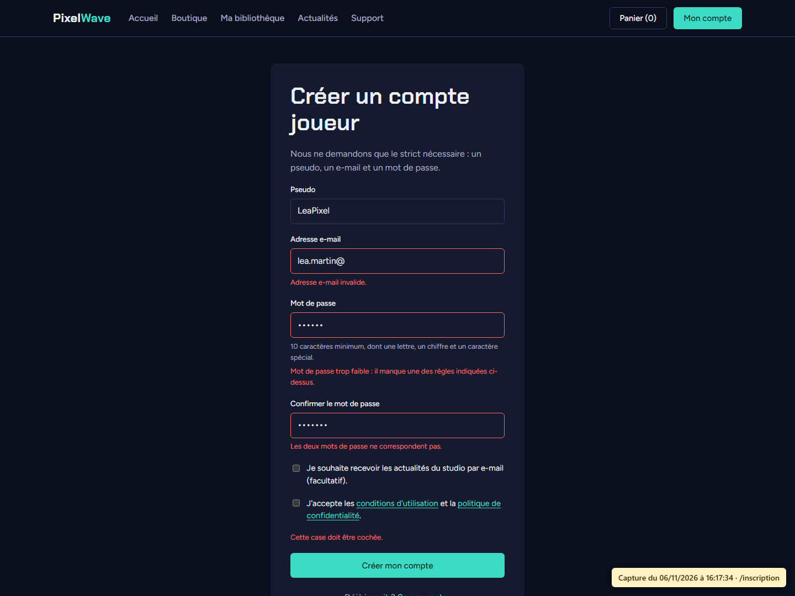

**REC-05 : blocage après 5 échecs de connexion**

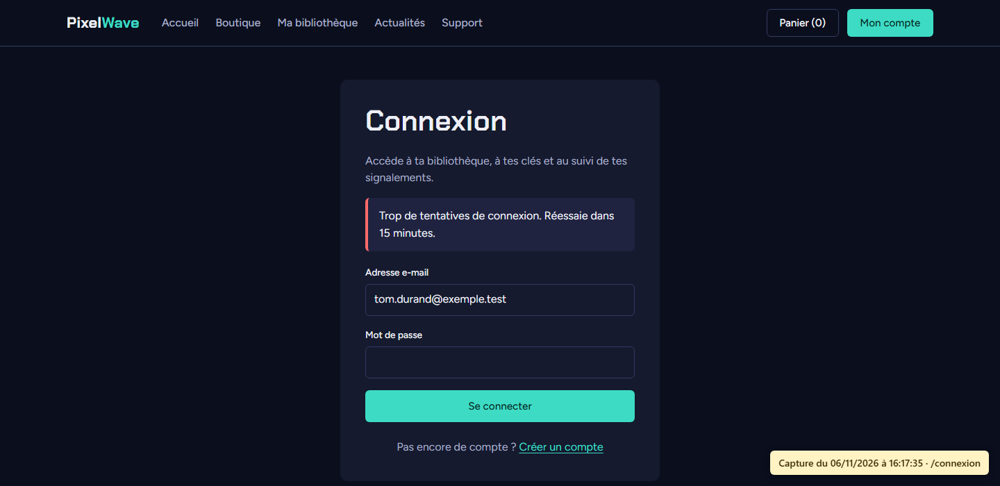

**REC-10 : jeu acheté visible dans la bibliothèque de NoobSaibot**

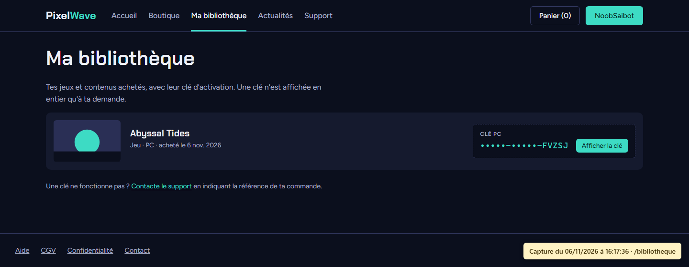

**REC-11 : Switch en rupture sur la fiche de Starlit Courier**

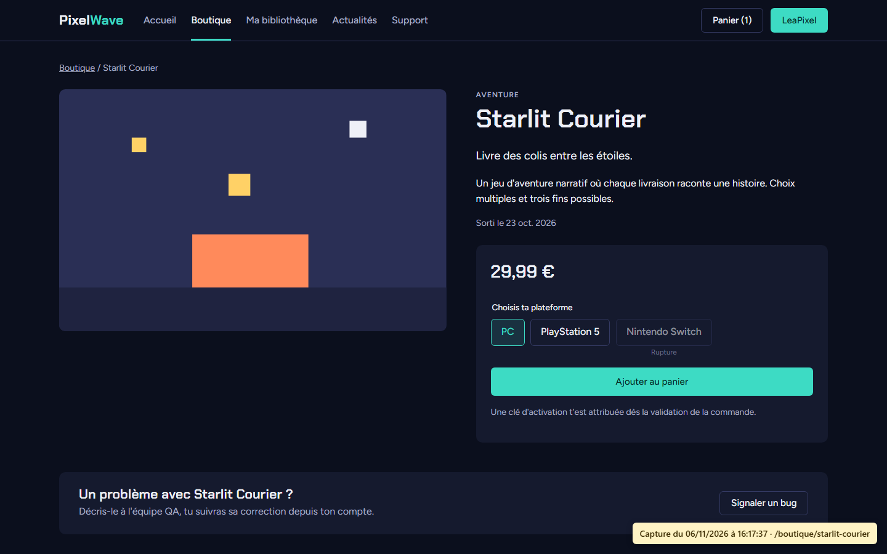

**REC-15 : clé du Circuit Nocturne affichée**

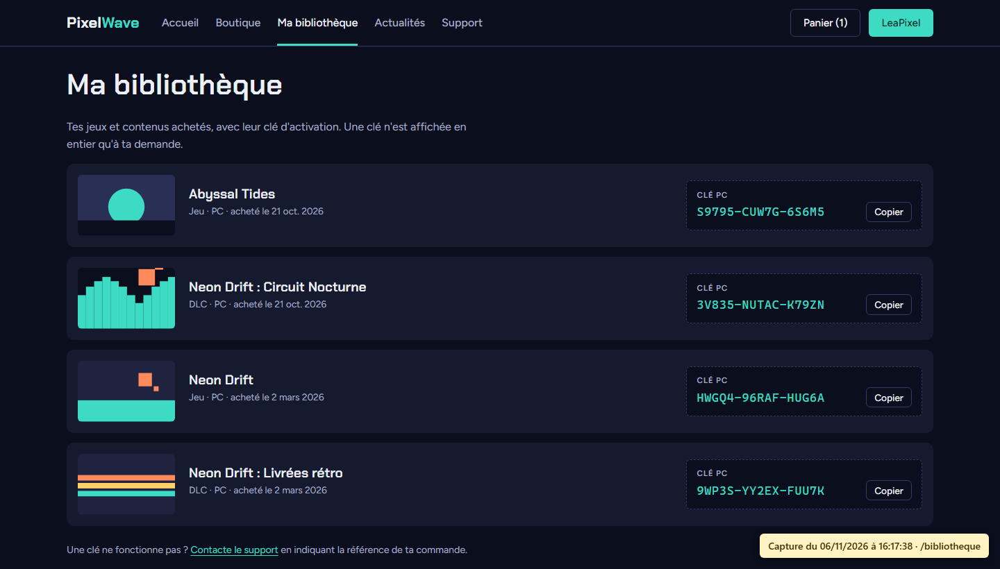

**REC-18 : ticket créé par LeaPixel**

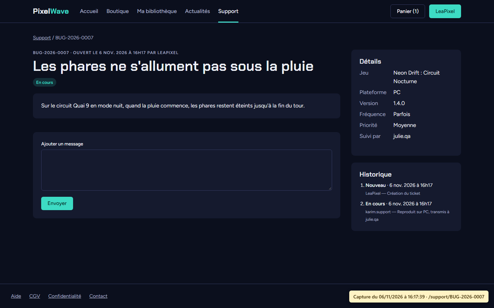

**REC-20 : le même ticket qualifié et affecté par le support**

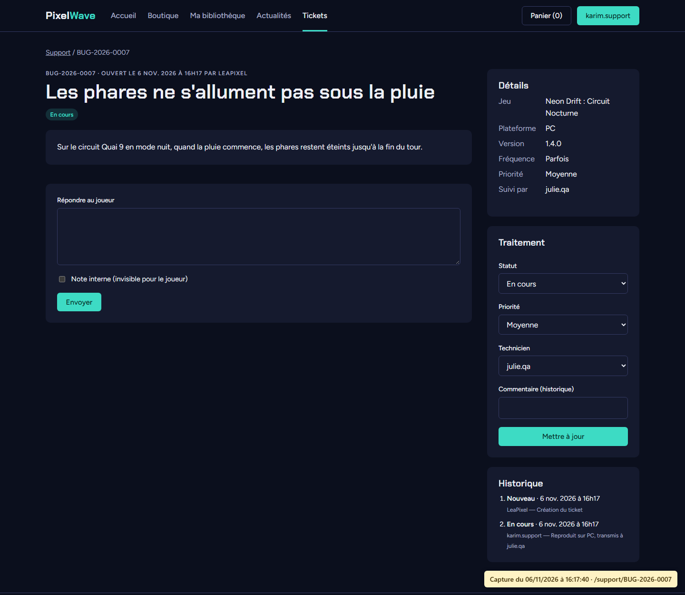

**REC-22 : LeaPixel essaie d'ouvrir le ticket d'un autre joueur**

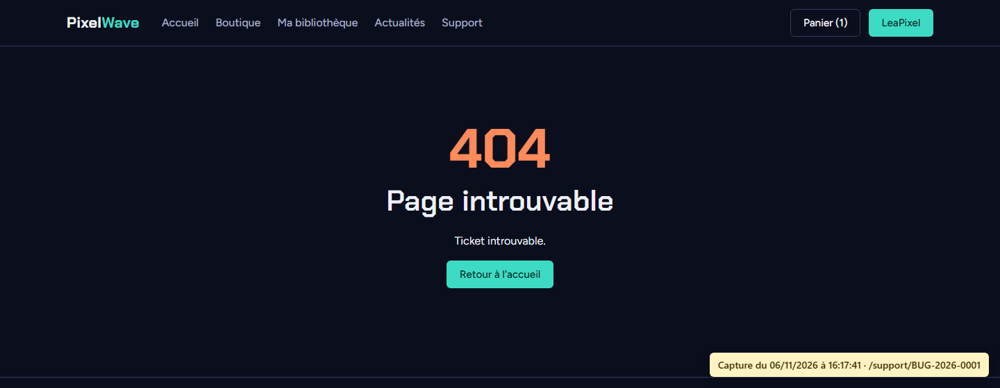

## 6. Suivi des anomalies

Chaque anomalie a sa fiche. Le modèle d'issue GitHub du projet (`.github/ISSUE_TEMPLATE/anomalie.md`) reprend les mêmes rubriques, pour les suivre aussi sur GitHub.

### ANO-01 : la page « Ma bibliothèque » ne s'affiche pas

- **Scénario :** REC-14
- **Gravité :** bloquante (le joueur ne peut plus voir ses jeux ni ses clés)
- **Description :** au lieu de la liste des jeux, la page affiche « Warning: Array to string conversion » puis « Array ».
- **Étapes pour reproduire :** se connecter avec LeaPixel, ouvrir `/bibliotheque`.
- **Cause :** la vue reçoit une variable `$contenu` (la liste des jeux), qui écrasait la variable `$contenu` du gabarit commun (le HTML de la page).
- **Correction :** variable du gabarit renommée en `$corpsPage` dans `src/Core/View.php` et `templates/layout.php`.
- **Re-test :** la page affiche les 4 jeux de LeaPixel ; tests automatiques relancés, tous OK.

### ANO-02 : boutons de formulaire trop larges

- **Scénario :** REC-01
- **Gravité :** mineure
- **Description :** sur « Mon compte », les boutons prennent toute la largeur du bloc, ce qui ne correspond pas à la maquette.
- **Cause :** le formulaire est en flexbox colonne, donc ses éléments s'étirent par défaut.
- **Correction :** `.formulaire > .btn:not(.btn--bloc) { align-self: flex-start; }` dans `style.css`.
- **Re-test :** boutons à la bonne taille.

### ANO-03 : cartes de l'accueil trop hautes

- **Scénario :** REC-08
- **Gravité :** mineure
- **Description :** les cartes « Promotions en cours » sont beaucoup plus hautes que sur la maquette.
- **Cause :** le même format d'image (4/5) servait pour la grille de 4 et celle de 5 colonnes.
- **Correction :** format 4/3 sur l'accueil et 3/4 dans la boutique.
- **Re-test :** conforme à la maquette.

### ANO-04 : blocs de clé mal alignés

- **Scénario :** REC-14
- **Gravité :** mineure
- **Description :** dans la bibliothèque, les blocs de clé ne sont pas alignés d'une ligne à l'autre.
- **Cause :** largeur de colonne qui dépendait de la taille du bouton.
- **Correction :** colonne de largeur fixe (340 px).
- **Re-test :** blocs alignés.

### ANO-05 : message affiché deux fois

- **Scénario :** REC-07
- **Gravité :** mineure
- **Description :** après deux tentatives d'ouvrir une page protégée, « Connecte-toi pour accéder à cette page. » apparaît deux fois sur la page de connexion.
- **Cause :** chaque tentative ajoutait le même message en session.
- **Correction :** `Session::flash()` n'ajoute plus un message identique à un message déjà en attente.
- **Re-test :** un seul message après deux tentatives.

### Erreurs dans les tests eux-mêmes

Au premier lancement, deux tests automatiques ont échoué à cause d'une erreur dans le test, pas dans le portail : `testFiltrePromotionEtPrixRemise` attendait un ordre de résultats qui ne correspondait pas au tri par défaut, et `testInscriptionRefuseDoublonsEtMotDePasseFaible` supposait un ordre des champs en erreur. J'ai corrigé les deux tests.

### Non-régression

Après la dernière correction (ANO-05), j'ai relancé toutes les campagnes automatiques : tests unitaires et d'intégration, recette de l'API et de la sécurité, jeux d'essai et collection Postman. Tout est passé (captures AUTO-1 à AUTO-4). J'ai aussi refait à la main les scénarios touchés par les corrections (REC-07, REC-08, REC-14).

**Bilan des anomalies :** 5 trouvées (1 bloquante, 4 mineures), 5 corrigées et retestées, aucune encore ouverte.

## 7. Procès-verbal de recette

| | |
|---|---|
| Projet | Système d'information PixelWave Studio, portail joueurs |
| Version recettée | 1.0, dépôt GitHub `Thenoxbob/pixelwave-studio`, branche `main` |
| Date | 6 novembre 2026 |
| Environnement | recette en local (PHP 8.4, MariaDB 11.4) |
| Maître d'ouvrage | comité de pilotage de PixelWave Studio |
| Maître d'œuvre | Ilhan Dulieu |

### Bilan

| Critère d'acceptation | Résultat | Atteint |
|---|---|---|
| tous les scénarios du cahier de recette conformes | 24 / 24 | oui |
| tous les tests automatiques passent | 45 / 45, 43 / 43, 21 / 21, 30 / 30 | oui |
| aucune anomalie bloquante ou majeure ouverte | 0 ouverte | oui |
| anomalies mineures restantes notées en réserve | aucune restante | oui |

### Réserves

1. Le paiement est simulé : il faudra brancher un prestataire de paiement (d'abord en mode test) avant d'ouvrir la boutique au public.
2. La recette a été faite en local : l'installation sur le serveur de la DMZ devra être validée avec `infra/tests/validation-portail.sh` (mission Mise en place de l'infrastructure).
3. Le message Discord n'a pas été testé avec un vrai salon.

### Décision

Les critères d'acceptation sont atteints. Je propose de **prononcer la recette avec réserves** : mise en production autorisée, les trois réserves ci-dessus étant à lever pendant la mise en place de l'infrastructure.

| | Maître d'ouvrage | Maître d'œuvre |
|---|---|---|
| Nom | | Ilhan Dulieu |
| Date | | 06/11/2026 |
| Signature | | |
