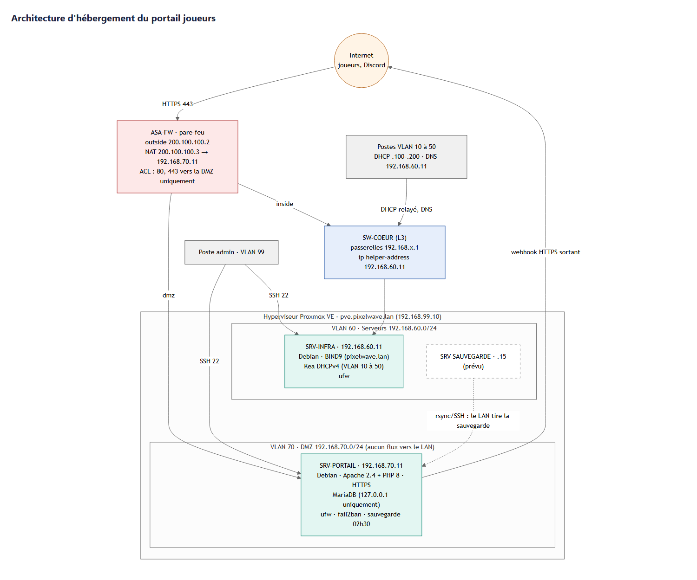

# Mission Mise en place de l'infrastructure : documentation technique

Monde 2, étape 2. Technologies : Debian, Apache, MariaDB, BIND9, DHCP (Kea), ufw.

Les scripts et les fichiers de configuration sont dans [`infra/`](../../../infra/).

## 1. Objectif

Il s'agit d'installer les serveurs qui hébergent le portail joueurs et qui fournissent les services réseau de base, en restant cohérent avec l'architecture du SI (livrable 1) et le schéma réseau (livrable 2) du Monde 1. Il y a deux serveurs :

- **SRV-PORTAIL**, dans la DMZ (VLAN 70, `192.168.70.11`) : le serveur web Apache avec PHP, la base MariaDB et le portail joueurs ;
- **SRV-INFRA**, dans le VLAN des serveurs (VLAN 60, `192.168.60.11`) : le DNS interne (BIND9) et le DHCP (Kea) pour les VLAN des services.

Ce sont deux machines virtuelles Debian sur l'hyperviseur du studio.

## 2. Architecture



Ce qu'il faut retenir :

- Le portail est dans la DMZ. Depuis Internet, on ne peut joindre que les ports 80 et 443 de SRV-PORTAIL, grâce à un NAT statique et une ACL sur l'ASA.
- La DMZ ne peut pas ouvrir de connexion vers le LAN (règle `no forward` de l'ASA, vue dans le livrable 2). Ça a trois conséquences :
  - la base MariaDB est installée sur le même serveur que le portail, et elle n'écoute que sur `127.0.0.1` ;
  - SRV-PORTAIL utilise des serveurs DNS publics, parce qu'il ne peut pas joindre le DNS interne ;
  - la sauvegarde est récupérée depuis le LAN : c'est le serveur de sauvegarde qui vient chercher les fichiers, et pas le portail qui les envoie.
- On administre les serveurs en SSH, uniquement depuis le VLAN 99 (management).
- Les postes des VLAN 10 à 50 reçoivent leur adresse par DHCP. Leur demande est relayée par SW-COEUR jusqu'à SRV-INFRA, et ils trouvent `portail.pixelwave.lan` grâce au DNS interne.

## 3. Mes choix techniques

| Besoin | Choix | Pourquoi | Ce que j'ai écarté |
|---|---|---|---|
| système | Debian 12 ou 13 | gratuit, stable, mises à jour de sécurité pendant longtemps, PHP 8 et MariaDB disponibles directement | Ubuntu Server, qui change plus souvent entre les versions |
| virtualisation | Proxmox VE | gratuit, interface web, sauvegardes et instantanés des VM intégrés | VMware ESXi, devenu payant en 2024 |
| serveur web | Apache 2.4 avec mod_php | demandé dans la mission, et la configuration par hôte virtuel est bien documentée | Nginx avec PHP-FPM, plus rapide mais avec plus de pièces à gérer |
| base de données | MariaDB, sur le même serveur | compatible MySQL (vu en cours, marche avec phpMyAdmin), et sur le même serveur parce que la DMZ est isolée du LAN | une VM de base de données séparée dans la DMZ, trop pour 50 000 comptes aujourd'hui |
| DNS | BIND9 | le plus utilisé, gère les zones directes et inverses, les ACL, et pourra déléguer une partie à l'Active Directory plus tard | dnsmasq, plus simple mais moins adapté à plusieurs zones |
| DHCP | Kea DHCPv4 | c'est le remplaçant officiel d'ISC DHCP, qui n'est plus maintenu, et sa configuration se vérifie avec `kea-dhcp4 -t` | isc-dhcp-server, abandonné par l'ISC depuis 2022 |
| pare-feu local | ufw | règles faciles à lire, en plus de l'ASA | iptables directement, plus dur à maintenir |
| protection SSH | fail2ban | bannit les IP après 5 essais ratés | |
| certificat | autosigné pour le labo, Let's Encrypt en production | le HTTPS est obligatoire puisqu'on fait passer des mots de passe et des clés de jeux | rester en HTTP |

## 4. Dimensionnement des VM

- **SRV-PORTAIL** : 2 vCPU, 4 Go de RAM, 40 Go de disque. Il fait tourner Apache, PHP et MariaDB. J'estime la base à moins de 1 Go pour 50 000 comptes, et il faut aussi la place pour 14 jours de sauvegardes compressées.
- **SRV-INFRA** : 1 vCPU, 1 Go de RAM, 16 Go de disque. BIND9 et Kea consomment très peu pour environ 80 postes.

Si le portail est très chargé (par exemple à la sortie d'un jeu), on pourra ajouter des vCPU et de la RAM à chaud dans Proxmox, puis mettre la base sur une VM séparée dans la DMZ.

## 5. Plan d'adressage

| Nom DNS | Adresse | VLAN | Rôle |
|---|---|---|---|
| `srv-portail.pixelwave.lan` (alias `portail`) | 192.168.70.11 | 70 (DMZ) | portail joueurs |
| `srv-web.pixelwave.lan` (alias `www`) | 192.168.70.10 | 70 (DMZ) | site vitrine |
| `asa-dmz.pixelwave.lan` | 192.168.70.1 | 70 (DMZ) | passerelle de la DMZ |
| `srv-infra.pixelwave.lan` (alias `ns1`) | 192.168.60.11 | 60 | DNS et DHCP |
| `srv-ad`, `srv-glpi`, `srv-fichiers`, `srv-supervision`, `srv-sauvegarde` | 192.168.60.10, puis .12 à .15 | 60 | réservées pour les prochaines missions |
| `sw-coeur.pixelwave.lan` | 192.168.99.2 | 99 | commutateur cœur |
| `pve.pixelwave.lan` | 192.168.99.10 | 99 | hyperviseur |
| adresse publique du portail | 200.100.100.3 | outside | NAT statique vers 192.168.70.11 |

Pour le DHCP, chaque VLAN de service (10 Direction, 20 Développement, 30 Marketing, 40 Support/QA et 50 Administration) a le même schéma : réseau `192.168.X.0/24`, passerelle `192.168.X.1`, adresses distribuées de `.100` à `.200`, DNS `192.168.60.11`, et un bail de 8 heures. Dans le VLAN 40, j'ai réservé l'adresse `.20` pour l'imprimante du support (`imp-support`).

Les serveurs (VLAN 60 et 70) et les équipements réseau (VLAN 99) ont des adresses fixes. Le VLAN 80 (Wi-Fi invités) est géré par son point d'accès avec un DNS public : il n'a accès ni au DNS ni au DHCP internes.

## 6. Configuration réseau à faire

Sur **SW-COEUR**, il faut relayer les demandes DHCP vers SRV-INFRA sur chaque interface VLAN des services :

```
interface Vlan10
 ip helper-address 192.168.60.11
! pareil pour Vlan20, Vlan30, Vlan40 et Vlan50
```

Sur l'**ASA**, il faut publier le portail avec un NAT statique et n'autoriser que le HTTP et le HTTPS depuis Internet :

```
object network SRV-PORTAIL
 host 192.168.70.11
 nat (dmz,outside) static 200.100.100.3
access-list OUTSIDE-IN extended permit tcp any object SRV-PORTAIL eq 443
access-list OUTSIDE-IN extended permit tcp any object SRV-PORTAIL eq 80
access-group OUTSIDE-IN in interface outside
```

## 7. Installation

### SRV-PORTAIL

1. Créer la VM (Debian, 2 vCPU, 4 Go, 40 Go) avec sa carte réseau sur le VLAN 70.
2. Installer Debian sans interface graphique (cocher « serveur SSH » et « utilitaires usuels ») et créer un compte administrateur. Le script interdit ensuite la connexion SSH directe en root.
3. Mettre l'adresse fixe, en suivant le modèle [`infra/srv-portail/interfaces.exemple`](../../../infra/srv-portail/interfaces.exemple).
4. Récupérer le dépôt et lancer l'installation :
   ```bash
   sudo apt install -y git
   git clone https://github.com/Thenoxbob/pixelwave-studio.git
   sudo bash pixelwave-studio/infra/srv-portail/install.sh
   ```
   Le script [`install.sh`](../../../infra/srv-portail/install.sh) installe Apache, PHP et MariaDB. Il limite MariaDB à `127.0.0.1` et supprime les comptes anonymes. Il copie le code dans `/var/www/pixelwave`, crée la base avec le jeu de démonstration, et crée un compte de base de données avec le minimum de droits et un mot de passe aléatoire. Il durcit aussi PHP, crée l'hôte virtuel HTTPS, et active ufw, fail2ban, les mises à jour de sécurité automatiques et la sauvegarde de nuit.
5. Vérifier avec `sudo bash pixelwave-studio/infra/tests/validation-portail.sh` (voir la partie 10).

### SRV-INFRA

1. Créer la VM (Debian, 1 vCPU, 1 Go, 16 Go) avec sa carte réseau sur le VLAN 60, et mettre l'adresse fixe ([`interfaces.exemple`](../../../infra/srv-infra/interfaces.exemple)).
2. Lancer `sudo bash pixelwave-studio/infra/srv-infra/install.sh`. Le script installe BIND9 et Kea, et vérifie la configuration (`named-checkconf`, `named-checkzone`, `kea-dhcp4 -t`) avant de redémarrer les services. Il active aussi ufw.
3. Configurer le relais DHCP sur SW-COEUR (partie 6).
4. Vérifier avec `sudo bash pixelwave-studio/infra/tests/validation-infra.sh`, puis depuis un poste du VLAN 40 avec `ipconfig /renew` et `nslookup portail.pixelwave.lan`.

### Mettre à jour le portail

```bash
sudo bash /var/www/pixelwave/infra/srv-portail/install.sh   # récupère la dernière version de main, garde config.php et la base
```

## 8. Sécurisation

Sur **SRV-PORTAIL** :

- ufw refuse tout par défaut, sauf les ports 80 et 443, et le 22 (SSH) seulement depuis le VLAN 99 ;
- SSH est limité en nombre de tentatives, fail2ban bannit une IP pendant 1 heure après 5 échecs, et la connexion directe en root est interdite ;
- les mises à jour de sécurité s'installent toutes seules (`unattended-upgrades`) ;
- seul Apache est accessible depuis le réseau, MariaDB n'écoute que sur `127.0.0.1` ;
- le site est en HTTPS (TLS 1.2 et 1.3), le HTTP redirige vers le HTTPS et l'en-tête HSTS est activé ;
- les versions d'Apache et de PHP ne sont pas affichées (`ServerTokens Prod`, `expose_php Off`), et les erreurs PHP ne s'affichent pas à l'écran ;
- Apache ne sert que le dossier `public/`, les fichiers cachés sont refusés, et `config.php` est en 640 (root:www-data) ;
- le compte de base de données de l'appli n'a que les droits `SELECT`, `INSERT`, `UPDATE` et `DELETE` ;
- côté application, les protections sont détaillées dans la [mission Développement](../2-developpement/L8_securite_code.md).

Sur **SRV-INFRA** :

- ufw n'autorise que le DNS (53) et le DHCP (67) depuis les VLAN internes, et le SSH depuis le VLAN 99 ;
- même règles SSH et mises à jour automatiques que l'autre serveur ;
- BIND n'écoute que sur `192.168.60.11`, il ne répond qu'aux VLAN internes, il refuse les transferts de zone et n'affiche pas sa version ;
- les fichiers de zone sont en 644 (root:bind).

## 9. Sauvegarde et restauration

- Chaque nuit à 2h30, le script [`pixelwave-sauvegarde.sh`](../../../infra/srv-portail/sauvegarde/pixelwave-sauvegarde.sh), lancé par cron, sauvegarde la base `pixelwave` (dump SQL compressé avec son empreinte SHA-256) et le fichier de configuration du portail. Les fichiers sont gardés 14 jours sur le serveur.
- Chaque semaine, Proxmox sauvegarde les VM complètes (vzdump), avec 4 semaines de conservation.
- Chaque nuit aussi, SRV-SAUVEGARDE vient récupérer le dossier `/var/backups/pixelwave` par rsync en SSH, pour avoir une copie en dehors de la DMZ.

Pour restaurer, on lance `sudo infra/srv-portail/sauvegarde/restauration.sh /var/backups/pixelwave/pixelwave-AAAAMMJJ-HHMM.sql.gz`. Le script vérifie l'empreinte (il refuse un fichier abîmé) et demande une confirmation. Ensuite il met le portail en maintenance, restaure la base, remet le portail en ligne et appelle `/api/v1/sante` pour vérifier que tout marche.

Il faudra faire un test de restauration et le noter : supprimer un ticket de test, restaurer la sauvegarde de la nuit, puis vérifier que le ticket est revenu et que `/api/v1/sante` répond `ok`.

## 10. Tests de validation

Deux scripts vérifient l'installation et affichent OK ou KO pour chaque point :

```bash
sudo bash infra/tests/validation-portail.sh | tee validation-portail-$(date +%F).txt
sudo bash infra/tests/validation-infra.sh   | tee validation-infra-$(date +%F).txt
```

### SRV-PORTAIL ([`validation-portail.sh`](../../../infra/tests/validation-portail.sh))

| ID | Ce qui est vérifié | Résultat attendu |
|---|---|---|
| VP-01 à VP-03 | Apache, MariaDB et fail2ban tournent | services actifs |
| VP-04 | `apache2ctl configtest` | `Syntax OK` |
| VP-05 | le HTTPS écoute | port 443 ouvert |
| VP-06 | MariaDB n'est pas accessible depuis le réseau | port 3306 seulement sur `127.0.0.1` |
| VP-07, VP-08 | ufw est actif et le SSH est réservé au VLAN 99 | règles présentes |
| VP-09 | `GET /api/v1/sante` | `"base_de_donnees": "ok"` |
| VP-10 | accès en `http://` | redirection 301 vers le HTTPS |
| VP-11, VP-12 | page d'accueil et catalogue de l'API | code 200 et 8 produits |
| VP-13 à VP-16 | en-têtes HSTS et CSP présents, versions d'Apache et de PHP cachées | conforme |
| VP-17, VP-18 | le code source et les fichiers cachés ne sont pas accessibles | 404 et 403 |
| VP-19, VP-20 | `config.php` en 640, compte de base sans droits d'administration | conforme |
| VP-21 à VP-23 | la sauvegarde se lance, l'archive est intacte, la tâche cron existe | conforme |

### SRV-INFRA ([`validation-infra.sh`](../../../infra/tests/validation-infra.sh))

| ID | Ce qui est vérifié | Résultat attendu |
|---|---|---|
| VI-01 à VI-03 | BIND9 tourne, la configuration et la zone sont valides | OK |
| VI-04, VI-05 | `portail.pixelwave.lan` et `srv-infra.pixelwave.lan` | 192.168.70.11 et 192.168.60.11 |
| VI-06 | résolution inverse de 192.168.70.11 | `srv-portail.pixelwave.lan.` |
| VI-07 | un nom sur Internet (`debian.org`) | résolu grâce aux forwarders |
| VI-08 | un nom qui n'existe pas | `NXDOMAIN` |
| VI-09, VI-10 | transfert de zone et version de BIND | refusé et cachée |
| VI-11 à VI-14 | Kea tourne, sa configuration est valide, il écoute sur UDP 67, 5 sous-réseaux sont déclarés | OK |
| VI-15, VI-16 | ufw est actif, le DNS écoute sur 192.168.60.11 | OK |

Où j'en suis : les scripts d'installation et de validation sont prêts et je les ai vérifiés (syntaxe Bash, fichier JSON de Kea valide, zones DNS cohérentes avec le plan d'adressage). Il reste à les lancer sur les VM du projet, puis à ajouter dans ce dossier les fichiers `validation-*.txt` qu'ils produisent, comme preuve.

## 11. Au quotidien

- Journaux d'Apache : `/var/log/apache2/pixelwave-acces.log` et `pixelwave-erreurs.log`.
- Erreurs PHP : `/var/log/pixelwave/php-erreurs.log`.
- Requêtes SQL lentes : `/var/log/mysql/mariadb-lent.log`.
- Journal du DHCP : `/var/log/kea/kea-dhcp4.log`, et les baux en cours dans `/var/lib/kea/kea-leases4.csv`.
- Pour ajouter un nom DNS : modifier `db.pixelwave.lan` sans oublier d'augmenter le numéro de série, vérifier avec `named-checkzone`, puis `rndc reload`.
- Pour voir les IP bannies : `sudo fail2ban-client status sshd`.
- Pour la supervision : `GET https://portail.pixelwave.lan/api/v1/sante` répond 200 si tout va bien, et 503 si la base ne répond plus.
